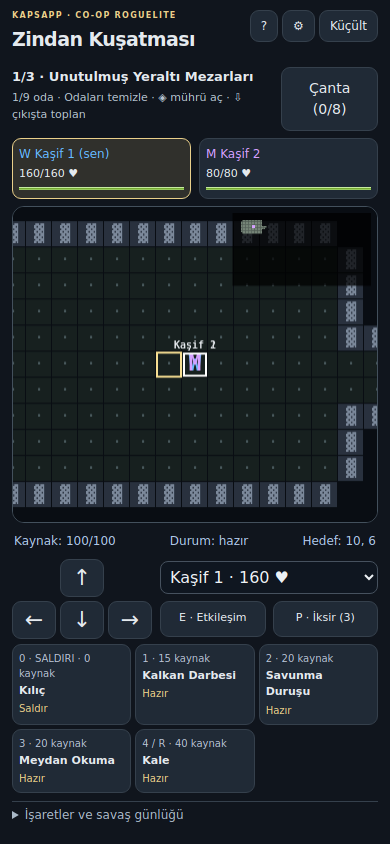
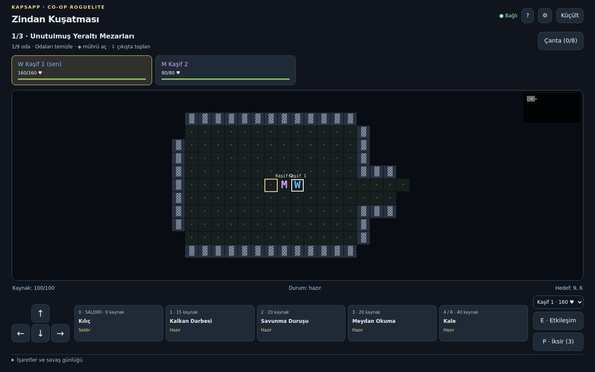

# Zindan Kuşatması / Dungeon Siege

KapsApp içinde ayrı bir 2–4 kişilik, gerçek zamanlı co-op oyun. Giriş: **Oyunlar → Zindan Kuşatması → Zindana Gir**; doğrudan rota: `/oyunlar?oyun=dungeon`.

## Çalışan özellikler

- Gerçek Socket.IO oturumları: oda oluşturma, açık oda listesi, gizli oda, isteğe bağlı parola, 40 bit rastgele katılım kodu, 2/3/4 kapasite, sınıf seçimi, herkes hazır olmadan başlamama.
- Savaşçı, Büyücü, Şifacı: temel saldırı, üç aktif yetenek ve ulti. Mana/dayanıklılık, zırh, kalkan, bekleme süreleri, yanma, zehir, donma, yavaşlama, sersemletme ve koruma sunucuda işlenir.
- Üç kat / tema: Yeraltı Mezarları, Kristal Mağaraları, Cehennem Kalesi. Her katta dokuz ana oda ve isteğe bağlı doğu hazine kolu. Tohuma bağlı oda boyutları, koridorlar, karşılaşmalar ve ganimetler.
- Altı normal düşman: İskelet, Goblin Okçu, Mağara Örümceği, Nekromansör, Zırhlı Muhafız, Gölge Suikastçı. Menzilli geri çekilme, sınırlı çağırma, zehir/ağ, ağır saldırı uyarısı ve arka saflara öncelik gibi farklı davranışlar.
- Üç boss: İskelet Kral, Kristal Golem, Cehennem Muhafızı. Çağırma, kalkan evresi, çizgi saldırıları, ateş bölgeleri ve ikinci evre davranışları. Büyük saldırılar önce işaretlenir.
- Her sınıf dostunu canlandırabilir. Canlandırma hasar, hareket, yetenek kullanımı, sersemleme veya mesafe nedeniyle kesilir. Yerde kalma süresi tekrarlanan düşüşlerde azalır; canlanan karakter kısa koruma kazanır.
- Kişisel ganimet: beş nadirlik, silah/zırh/tılsım/kalıntı yuvaları, 8 eşyalık çanta, değiştirme ve bırakma. Kalıntılar buz alanı, ikinci patlama, canlandırma koruması veya kritik darbe kaynağı verir. Eşyalar sefer sonunda sıfırlanır.
- Üç zorluk; sabit başlangıç parti büyüklüğüne göre düşman canı ve karşılaşma yoğunluğu. Aynı sınıftan ekipler desteklenir.
- Bütün zorunlu odalar ve mühür tamamlandıktan sonra canlı ekip çıkışta toplanır; 3 saniyelik geçiş atomik olarak uygulanır. Üçüncü katın çıkışı zaferdir. Son boss ile ekibin aynı anda ölmesi yenilgidir.
- Türkçe rehber, çanta karşılaştırması, durum göstergeleri, savaş günlüğü, hızlı işaretler, kişisel istatistikler, başarı/yenilgi ekranı.
- Kalıcı hesap geçmişi ve kozmetik unvanlar: ilk zaferde Kuşatma Kahramanı, 10 zaferde Zindan Ustası. KapsApp çip ekonomisine dokunulmaz.

## Mimari ve dosyalar

| Konum | Sorumluluk |
|---|---|
| `src/games/dungeon/types.ts` | Ortak veri modeli |
| `src/games/dungeon/definitions.ts` | Sınıf, düşman, zorluk, yetenek tanımları |
| `src/games/dungeon/generation.ts` | Tohumlu üretim, BFS yol bulma, görüş hattı, bağlantı kontrolü |
| `src/games/dungeon/engine.ts` | 100 ms sabit adım; hareket, savaş, AI, ganimet, katlar ve sonuç |
| `src/server/dungeonServer.ts` | Kimliği doğrulanmış Socket.IO olayları, odalar, yeniden bağlanma, kalıcı sonuçlar |
| `src/components/games/dungeon/DungeonGame.tsx` | Menü, lobi, HUD, kontroller, çanta, rehber ve sonuç ekranı |
| `src/components/games/dungeon/DungeonCanvas.tsx` | Canvas karakter haritası, keşif, kamera, mini harita, uyarılar ve mermiler |
| `src/components/games/dungeon/dungeon.css` | Oyunla sınırlı responsive görünüm |
| `src/components/Games.tsx` | Ayrı oyun kartı ve giriş |
| `server.ts` | Mevcut doğrulama sonrasında DungeonManager kaydı ve tablo başlangıcı |
| `package.json` | Dört test komutu; yeni çalışma zamanı bağımlılığı yok |
| `tests/dungeon.*` | Motor, ağ, sefer, tarayıcı ve performans doğrulamaları |

Tarayıcı hasar/can/ganimet sonucu göndermez; yalnızca sıra numarası ve kat numarası taşıyan komut gönderir. Pozisyon, menzil, görüş, kaynak, bekleme süresi, oturum ve mevcut kat sunucuda denetlenir. Harita yalnızca değiştiğinde veya yeniden eşitlemede gönderilir; hareketli durum 10 Hz yayınlanır. Görüş dışı düşmanlar anlık durumdan süzülür. Keşif parti tarafından paylaşılır.

## Çok oyunculu davranış

- Mevcut KapsApp token doğrulaması kullanılır; istemcinin ilettiği kullanıcı kimliği yetki kabul edilmez.
- Bir oyuncu aynı anda tek zindan odasındadır. Aynı hesap ikinci sekmede odasına girerse eski sekme kontrolü kaybeder; ikinci karakter oluşturulmaz.
- Bağlantı koptuğunda 60 saniyelik geri dönüş süresi vardır. Can, kaynak, hasar etkileri ve bekleme süreleri sıfırlanmaz. Karakter yeni komut veremez; mevcut etkiler/alan saldırıları zarar verebilir. Süre dolarsa karakter düşer.
- Oda sahibi ayrıldığında sahiplik bağlı oyuncuya geçer. Yeni katılımcılar başlayan sefere alınmaz; mevcut katılımcı geri dönebilir.
- Açıkça ayrılmak seferi terk etmektir. Tamamlanan sonucun uygunluğu sonuç anında sabitlenir; sonradan çıkmak zaferi silmez.
- `dungeon_results` anahtarı `(run_id,user_id)` olduğundan yeniden denenen yazım kayıt/ödül çoğaltmaz. Kısmi geçici yazım hatasında kalan kayıtlar yeniden denenir; kayıt bekleyen boş oda hemen atılmaz.
- İşlemler soket başına saniyede 25 ile sınırlıdır. Yeni katılım denemeleri hesap başına dakikada 10 ile sınırlıdır ve bağlantıyı yenilemek bütçeyi sıfırlamaz. Oda parolası durum yayınlarında yer almaz.
- Sunucu yeniden başlarsa devam eden seferler geri yüklenmez. İstemci eski seferi sürüyormuş gibi göstermeden oda menüsüne döner ve açıklama gösterir.

## Kontroller ve mobil tasarım

WASD / yön tuşları: hareket. Haritaya tıklama/dokunma: hedef. `0`: temel saldırı; `1–3`: yetenek; `4` veya `R`: ulti; `E`: etkileşim/canlandırma; `P`: iksir; `Tab`: çanta; `Esc`: ayarlar.

Mobilde yön takımı, beş yetenek, dost seçimi, etkileşim ve iksir düğmeleri vardır. Oyun tam görünür alanı kullanır; yatay telefonda daha sıkı HUD gösterilir. **Küçült** seferden ayrılmadan KapsApp’a dönmeyi sağlar. Mevcut sesli sohbet bileşeni ve bağlantısı değiştirilmez. Oyun sesi bağımsızdır.

Rehber/çanta pencereleri kendi içinde kayar; klavye odağı pencere içinde tutulur. Düzenlenebilir alandayken oyun kısayolları devreye girmez. Kontrast ve metin boyutu seçenekleri, cihazın azaltılmış hareket tercihi, renk yanında sınıf/düşman harfleri bulunur.





## Çalıştırma ve dağıtım

```sh
npm ci
npm run dev
# Üretim:
npm run build
npm start
```

KapsApp'ın mevcut veritabanı, kimlik doğrulama ve Socket.IO yapılandırması kullanılır; yeni ortam değişkeni veya servis gerekmez. Başlangıçta `CREATE TABLE IF NOT EXISTS dungeon_results` uygulanır. Ayrı manuel veri taşıması yoktur. Tablo oluşturulamazsa oyun bellekte oynanabilir, kalıcı geçmişin kullanılamadığı gösterilir; depolama düzeltildikten sonra sunucu yeniden başlatılmalıdır.

Odalar tek Node sürecinin belleğindedir. Birden fazla süreç/instance için oda sahipliği paylaşımı uygulanmamıştır; mevcut tek süreç veya uygun oturum yönlendirmesi gerekir. Süreçler arasında aktif sefer taşınmaz.

## Gerçek iki istemciyle doğrulama

1. İki ayrı hesapla iki tarayıcı/cihazda KapsApp'a gir.
2. Oyunlar → Zindan Kuşatması. İlk hesap oda oluştursun; ikinci hesap kodla katılsın.
3. Sınıfları seçip iki oyuncu da Hazırım desin. Oda sahibi başlatsın.
4. Bir oyuncuyu hareket ettir; diğer ekranda aynı hareketi kontrol et. Mühür, karşılaşma, ganimet ve canlandırma akışlarını dene.
5. Bir bağlantıyı kısa süre kesip geri aç; aynı karakterin mevcut can/pozisyonuyla dönmesini kontrol et.
6. Üç kattaki zorunlu odaları tamamlayıp her katta çıkışta toplan. Son kat çıkışından sonra iki ekranda aynı zaferi ve kalıcı geçmişi kontrol et.

Otomatik tarayıcı testi de gerçek iki Socket.IO bağlantısı üzerinden yasal komutlar gönderir. Test kontrolcüleri otomasyondur; insan oyun testi olarak sunulmaz.

## Test sonuçları

Gerçek test sayıları, iki tarayıcılı tam sefer, performans ölçümleri ve test kapsamı için [doğrulama raporu](dungeon-verification.md).

## Bilinen sınırlar

- Fiziksel Android/iOS cihazı, Safari, Firefox ve Edge üzerinde doğrulama yapılmadı. Chromium ekran boyutu emülasyonu fiziksel cihaz testi değildir.
- Canlı kapsapp.online dağıtımı ve canlı kullanıcılarla sesli sohbet + oyun birleşimi ayrıca doğrulanmadı.
- Sunucu yeniden başlatıldığında sefer checkpoint'i geri yüklenmez. İnaktif odalar temizlenir; çok saatlik üretim soak testi yapılmadı.
- Hızlı eşleştirme, ticaret/merchant ekonomisi, dost ateşi seçeneği, tuş yeniden ataması ve ek alternatif başlangıç setleri bulunmuyor. Temel üç sınıfın tüm yetenekleri kullanılabilir.
- Savaş ayarları için deterministik kontrolcü testleri yapıldı. İnsanlarla 20–35 dakikalık sefer süresi veya her oyuncu becerisi için kusursuz denge kanıtlanmış değildir.
- Kalıcı ilerleme istatistik ve kozmetik unvandır; ekipman sefere özeldir. KapsApp'ın diğer oyunlarına otomatik çip aktarımı yoktur.
- Ses geri bildirimi küçük sentezlenmiş tonlardır; ayrı ses varlığı paketi kullanılmaz. Canvas ağırlıklı savaşın ekran okuyucuyla tam eşdeğer oynanışı uygulanmamıştır.
