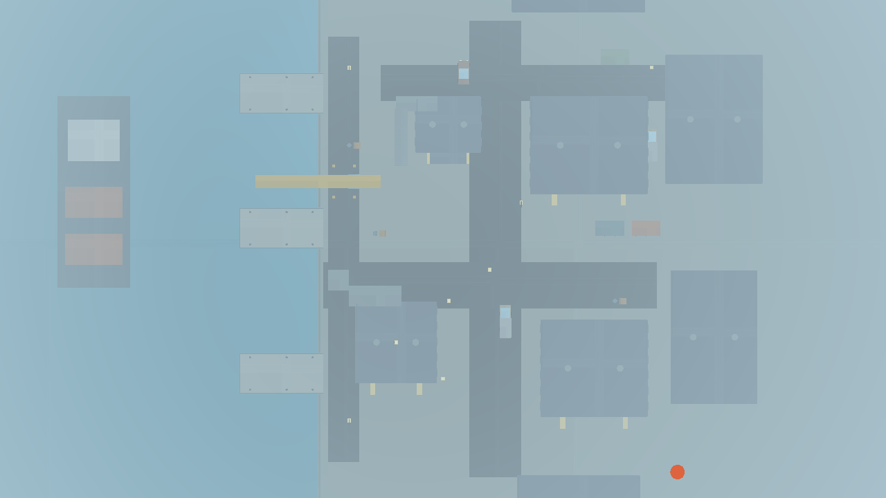
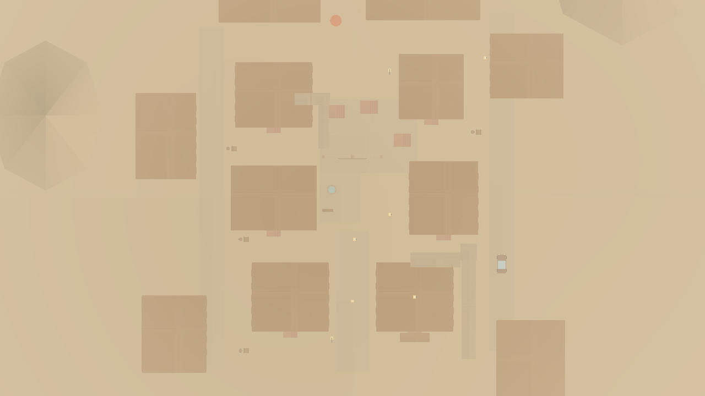
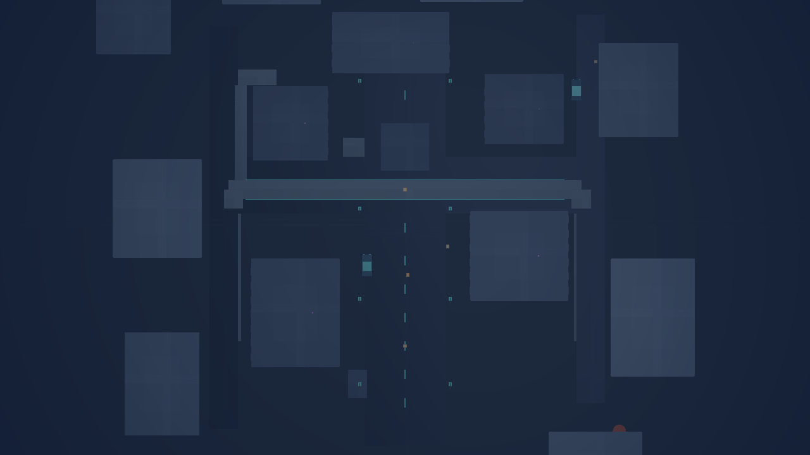

# KapsStrike repair — implementation and verification

Base: c38af335811d73f4df376bdad8dfdd12a75e7fc6.

## District rebuild — 29 October 2026

The old shared perimeter/arena generator was removed. Each stable map ID now selects its own authored 96 m district:

- **Dust Town:** branching market lanes, two curved stone arches, a well courtyard, shutters/awnings, six enterable buildings, stairs and connected roof decks. Side streets provide separate west/centre/east approaches.
- **Neon City:** a skyscraper boulevard, an elevated 74 m skyway with two ramps, a lower transit platform, an independent club-roof staircase, shop terminals and lighted storefronts. Upper floors and setbacks give its massing a different vertical profile.
- **Liman Mahallesi:** a stepped coastline, three piers, gantry crane, distant freighter, customs office, open warehouse/loading lanes, trucks and a small container cluster. Water barriers follow the shoreline; there is no four-wall arena enclosure.

Buildings have doors, side/front windows, cornices, roof fittings and actual interior clearance. Original deterministic 128 px material tiles cover plaster, masonry, brick, corrugated metal, wood, concrete, asphalt, glass and water; sign textures are 256×64. Static meshes merge by material; distant small fittings are reduced on Low. Physics caches the collidable subset so facade detail does not increase capsule collision work. The client and authoritative server use the same numeric map solids. Visible backdrop buildings remain solid where they meet the playable area.

The test suite now has **168 passing tests**, including all 30 spawns, three continuously clear ground routes per map, every authored ramp, all three staircases and through-door standing clearance. Two independent browser contexts (desktop and touch emulation) passed real Socket.IO movement/combat/death/score/respawn on **each** of the three rebuilt maps. `npm run lint` and `npm run build` passed. `npm run test:strike:maps` loads the actual textured WebGL scenes and captures these level street and overhead views:

| District | Street view | Layout |
| --- | --- | --- |
| Liman Mahallesi | [Street](kapsstrike-port-street.png) | [Plan](kapsstrike-urban-overview.png) |
| Dust Town | [Street](kapsstrike-dust-street.png) | [Plan](kapsstrike-dust-overview.png) |
| Neon City | [Street](kapsstrike-neon-street.png) | [Plan](kapsstrike-neon-overview.png) |

These are actual game renders, not concept art. Short Low/960×600 SwiftShader observations were approximately 56/49/48 FPS for port/dust/neon; they do not establish physical desktop or phone frame rates. Physical Android/iOS hardware and production deployment were not tested in this environment. Deploy client **and** server together so map versions agree.

## Current implementation

The repaired game retains the existing Babylon/React module and authenticated Socket.IO server. It adds one-controller match startup, GPU-ready/snapshot loading gates, account-backed eight-skin selection, live control rebinding, authoritative melee, three redesigned districts, and the networking/combat corrections described below. Existing KapsApp authentication and media code were not replaced.

### Verification and limits

- `npm run lint` and `npm run build`: passed on the final source.
- `npm run test:strike`: **168 passed, zero failures**. Includes 216,000 movement fuzz steps, map spawn/route/ramp checks, real libSQL profile persistence, private-friend invite authorization, duplicate sessions, bounded inputs, weapons, melee range/cover/cooldowns, assists and same-step trades/draws.
- `npm run test:strike:browser`: all three training maps, actual WebGL, movement/fire/reload/ADS/death/respawn/cleanup, High shadows, React menu/HUD/exit passed.
- `npm run test:strike:menu`: 390×844, 768×1024 and 1440×900 layouts and unsupported-WebGL handling passed.
- `npm run test:strike:network`: two isolated Chromium contexts, including touch emulation, repeated on all three districts. Real Socket.IO; same ready 3D map; movement, fire, confirmed damage/death/score/respawn; eight skins and 3D rotation/profile persistence/remote appearance; binding conflicts and live ESC-menu remapping; wheel debounce; normal/heavy melee; live scoreboard; no automatic microphone request; room and engine cleanup.
- 8 and 10 real Socket.IO client load scenarios passed with delayed inputs corresponding to 0/100/200/300 ms symmetric RTT and deterministic jitter. Also checked room-full rejection, password denial/acceptance, full-room session replacement, reconnect, old-disconnect isolation, host migration and match results. The delay fixture delays application input delivery; it is not a physical WAN or TCP packet-loss test. These synthetic clients do not render ten simultaneous browser canvases.
- Latest software-rendered 960×600 Low training snapshots: Port 56.22 FPS / 69 draws, Dust 49.24 / 54, Neon 48.05 / 51. These are short Chromium/SwiftShader observations, **not physical GPU or mobile performance guarantees**.
- Other-game regression suites passed in the earlier verification: Battle Royale 5026, Kapstorial 478, Dungeon 1169. No files in their game engines were changed.
- Physical Android/iOS/Edge/Opera, long production matches, live KapsApp accounts/database statistics and simultaneous real camera/screen-share calls were not exercised. No claim of universal bug-free operation is made.

### Running and deployment

Use `npm ci`, `npm run build`, and the existing `npm start`/PM2 deployment. There is no additional game daemon, public secret or port. Deploy client assets and the Node server together because maps and combat rules are shared. The existing database client lazily creates `kapsstrike_profiles`; existing user/statistics tables are retained. Match simulation still lives in server memory; process-restart match recovery is not added. Separate expiring invite tokens are not added; friend authorization, cryptographic room codes and room passwords apply.

## Implementation history

## Reproduced cause

The host sent both `strike:start_game` and `strike:start_match`. Each reset a live round and broadcast both `room_state` and `match_started`. Both client listeners constructed a controller. The same browser regression on the unmodified base observed **four controllers for one match**, failing the single-controller assertion. Disposing old controllers also releases pointer lock. Multiplayer pause callbacks did not reveal a pause menu, leaving stopped controls without a way to resume.

## Fixes

- Send one start command; server start aliases are idempotent during a round.
- One controller per room/round, stable event subscriptions, explicit pointer-lock gesture on desktop, touch starts without pointer lock.
- Map/snapshot loading stages, 12-second synchronization timeout, visible errors, retry and exit.
- Shared 120 Hz physics timebase inside 60 Hz server callbacks, 30 Hz snapshots. One queued input per physics step; capped queue and prediction history, validation of weapon/tick/axes and duplicate queued sequences.
- Reconciliation restores authoritative movement, health, ammo and weapon timers and resets the acknowledged sequence before replay.
- Training-only hazard/respawn rules cannot grant client-authoritative multiplayer life changes.
- Correct semi-automatic trigger semantics and reload completion while idle.
- Hitmarkers/damage/respawn feedback only affects the relevant player; remote shots do not recoil the local viewmodel. Kill-feed aliases deduplicated.
- Multiplayer hides offline target meshes; wheel events are throttled and require active game controls; touch inputs reset on pause.
- Repaired out-of-sync dependency lockfile (`npm ci` failed on the base).

## Validation

- `npm run test:strike`: 142 passed at this milestone, including existing training/scene/server tests and new duplicate-start/flood regressions.
- `npm run lint`: passed.
- `npm run build`: passed.
- `npm ci --ignore-scripts`: passed after lockfile repair.
- `npm run test:strike:browser`: all three training maps, High shadows and React menu/HUD/exit passed.
- `npm run test:strike:menu`: 390×844, 768×1024 and 1440×900 menu/settings/controls and unsupported-WebGL layouts passed.
- `npm run test:strike:network`: two independent Chromium browser contexts (one desktop, one touch/mobile emulation), real Socket.IO server and production manager/controller/renderer/UI, repeated for Warehouse, Dust and Neon. Actual WebGL via SwiftShader. Create/join/ready/start; remote character meshes; server-observed movement; actual fire inputs/raycast/ammo/damage/death/kill count/respawn; victim does not receive shooter hitmarker; ESC/resume UI and disposal.
- Browser fixture identities are synthetic and supplied by the test-only server. Production authentication was not bypassed or altered. A clear firing lane and expired protection are set server-side in the combat fixture; gameplay outcomes are produced by real gameplay code.

## Historical scope remaining after the first milestone

This milestone does **not** complete the uploaded specification. Eight skins/3D preview/account persistence, full rebinding UI, knife, redesigned city maps and extensive hardware/network/long-match performance validation remain. No physical Android/iOS/Edge/Opera or production-account/live-call validation was performed. Software-rendered Chromium results do not establish physical GPU FPS guarantees. Existing broader server tests are largely mock-transport tests; the new browser test adds real transport coverage for two clients only.

## Second milestone — controls and melee

- Physical-code rebinding editor: keyboard/modifier combinations, mouse buttons, wheel directions, overlap warnings, explicit replacement, individual/all resets. ESC remains a recovery shortcut. Settings persist locally immediately and update controller bindings. Mobile touch controls remain available.
- Dedicated sixth knife slot (original five number slots preserved), wheel wrap/debounce and previous-weapon action. Normal 40 / heavy 65 damage, 2.2 m raycast range, 0.5 / 0.9 s cooldowns, no ammo consumption, authored low-poly viewmodel/swing/audio and third-person blade representation. Server validates combat and cover.
- Equip requests no longer disappear during an equip delay; selecting restarts the delay, preserving fire cooldown. Fixed server scheduling uses elapsed time to avoid timer rounding changing match duration.
- 147 unit/scene/server/binding tests passed. Added held-trigger/cooldown/heavy, out-of-range and wall-blocked knife assertions. Original five firearm tests retained.
- Two-context WebGL network test additionally uses remapped I/F movement/fire, actual editor persistence, synchronous wheel burst debounce/wrap, sixth-slot selection and server-confirmed 40 melee damage. Three-map training and High/React browser regression passed after adding the sixth weapon.
- Full skins and redesigned maps remain outstanding. The local binding store is device-specific; account sync is not claimed.

## Third milestone — characters and damage feedback

- Eight original cosmetic model variants with distinct helmets/hoods/hat/antenna/fins/packs. Shared authored geometry drives multiplayer and draggable 3D preview.
- Preview projects the actual model meshes with a small CPU rasterizer and Babylon NullEngine; no second WebGL context is allocated. This replaced a reproducible native SIGSEGV when disposing a preview WebGL scene in the installed Chromium/SwiftShader environment. Final preview close/network test passed with no retained preview engine.
- Separate `kapsstrike_profiles` table is created idempotently on demand; validated skin IDs persist through authenticated socket handlers. Account identity comes exclusively from the existing server socket user. Profile writes are throttled. Database-backed persistence and isolation are tested with real in-memory libSQL.
- Remote models receive server skin IDs, team bands, normal depth-tested geometry outlines (disabled on Low), and brief confirmed-hit flashes. All skins keep identical gameplay hitboxes.
- Confirmed local damage produces a bounded vignette, directional warning, small camera roll and critical-health label. Foreign player events cannot trigger local hitmarkers/recoil/respawn.
- Fixed code-entry UI so actual `KS-xxxx` codes and their prefix-free form are accepted, rather than enforcing an incompatible six-character input.
- 149 unit/scene/server/profile tests passed. Two-browser test additionally cycles the eight actual meshes, saves a skin, observes it remotely, rotates/closes the preview and tests binding-conflict cancellation and full-code joining.
- Physical-browser/production-account/live-call claims remain outside these automated fixture checks.

## Fourth milestone — districts, synchronization and combat

- Replaced the shared arena perimeter/box layouts with distinct district plans and skylines: **Urban Strike / Liman Mahallesi** (cross streets, shops/interiors, vehicles, sidewalks and balcony access), **Dust Town / Sarnıç Pazarı** (offset courtyards, archway, market stalls and roof route), **Neon City / Üst Hat** (night lighting, signs, reflective-road specular response, bridges and multiple ramp levels). Stable map IDs preserve room links.
- All ten spawns are collision-safe and connected through standing-height ground routes. Every authored ramp has a movement traversal test. A bridge/ramp collision found by the traversal test was corrected.
- Static geometry batches share materials, retaining numeric collision/ray geometry independently. Low DPR is capped; optional dynamic resolution adjusts gradually with hysteresis. Effects remain pooled and character outlines remain depth-tested ordinary geometry.
- Reconciliation restores authoritative ammo/timers and replays inputs correctly. Jitter adjusts the interpolation window; extrapolation is capped at 50 ms with collision-fit checks. Local shot/reload effects are immediate, while actual hits/scores remain server-confirmed.
- Canonical room codes now work with or without the prefix. New codes use 64-bit cryptographic randomness. Duplicate/full-room joins replace only the old gameplay session; an old disconnect cannot erase the new membership. Leaving for a different room no longer leaves an old player behind.
- Shared spread/damage/fire-delay functions keep client/server weapon rules aligned. Same-step hits resolve after all valid shots, allowing trades; tied score limits produce a draw. Recent damage contributions award assists. The live scoreboard consumes authoritative snapshots rather than retaining lobby statistics.
- Private invites validate the authenticated player's room and accepted-friend relationship and go directly to recipient sockets. Room codes are no longer broadcast globally through the invite event.
- Loading completes only after initial state and actual scene readiness; failures time out and offer retry/exit. Desktop pointer lock requires a user gesture; touch startup remains independent of pointer lock. Controls can be rebound from the ESC menu and apply immediately.

### Rendered district overview captures

These are instrumented Babylon test-camera views of the authored geometry, not mockups or live-production screenshots.

