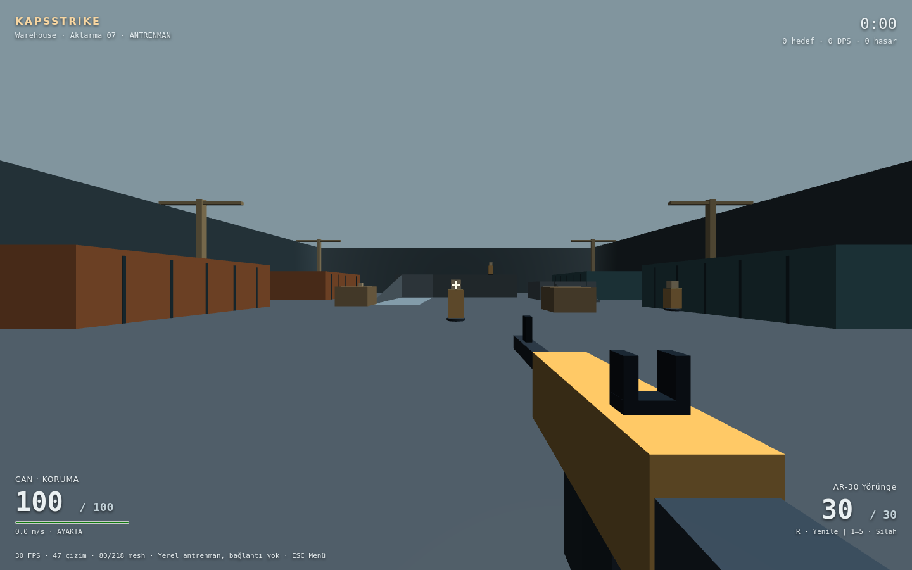

# KapsStrike Aşama 1 — Gerçek doğrulama kaydı

29 Ekim 2026. Sonuçlar bu çalışma ortamında çalıştırıldı; canlı kapsapp.online dağıtımı veya fiziksel ekran kartında benchmark değildir.

## Geçen kontroller

| Kontrol | Sonuç |
|---|---|
| Temiz bağımlılık kurulumu | Ayrı dizinde `npm ci --ignore-scripts --package-lock-only=false` başarılı; 331 paket. Mevcut native DB paketlerinin kurulum betikleri bu kontrolde çalıştırılmadı. |
| `npm run lint` | TypeScript başarılı |
| `npm run build` | İstemci, sunucu bundle ve SEO üretimi başarılı |
| `npm run test:strike` | **127 geçti, 0 başarısız** |
| `npm run test:strike:browser` | **3 haritada gerçek WebGL oynanış akışı + High profil gölge testi + gerçek React menü/HUD/çıkış akışı geçti** |
| `npm run test:strike:controller` | 3 haritada browser input + NullEngine kontrol akışı geçti; bu test GPU görüntüsü/FPS testi değildir |
| `npm run test:strike:menu` | 390×844, 768×1024, 1440×900: ayarlar, kontroller, taşmama ve desteklenmeyen WebGL durumu geçti |
| Mevcut Battle Royale | **5.026/5.026** geçti |
| Mevcut Kapstorial | **478/478** geçti |
| Ses / ekran paylaşımı kuralları | **55/55** geçti; ilgili uygulama kodu değiştirilmedi |

Playwright mevcut testlerde kullanılan **1.51.1** sürümüne sabitlendi. Babylon **8.50.2** sabit sürümdür. Kilit dosyası üretim bağımlılıklarının mevcut sürümlerini yükseltmeden Babylon ve gerekli test/opsiyonel platform kayıtlarını içerir.

## 127 testin kapsamı

- 3 haritanın spawn, hedef, hazard noktaları ve geometri kimlikleri.
- Hızlanma, diagonal hız, sürtünme/slide, yeni tuş basımı gerektiren zıplama, havadan zemine dönüş ve maksimum hız.
- İnce duvar/köşe çarpışması, çömelme tavanı, gerçek merdiven ve her haritadaki beş rampanın alçak uçtan yürünebilirliği.
- 30/60/120 kare gruplamasıyla aynı sayıda sabit adımın aynı hareket sonucunu üretmesi.
- Rampa kamasında ray kesişimi ve üst boşluğunda kesişmeme; kutu/cover isabet engeli.
- Beş silahın şarjör, ateş aralığı, yarı otomatik tetik bırakma, reload kilidi/tamamlanması ve silah değişimi.
- Kafa/gövde, shotgun sekiz ayrı ve deterministik saçma yönü, sıfır mühimmat, korunma/ölüm/respawn, aynı oyuncu ID'sinin korunması, eski/bozuk komutlar ve sınırlı ayarlar.
- 90 değişken komut akışı × 2.400 sabit adım = **216.000 simülasyon adımı**; sonlu koordinat/can, harita sınırı, hız ve olay kuyruğu sınırları.
- Hareketli kuklaların katı geometri içine girmemesi.
- Üç harita × üç grafik profilinin Babylon sahne kurulumu, beş viewmodel, efekt mesh sayısının atışta büyümemesi ve dispose.
- 20 tekrar yükle/boşalt döngüsünde EngineStore sayısının başlangıca dönmesi.
- Sahne kurulumu hata verirse kısmi engine/sahnenin bırakılması.

## Gerçek WebGL tarayıcı testi

Chromium headless + **SwiftShader yazılımsal WebGL** kullanıldı. Ekranlar 3D motorun gerçekten çizdiği görüntülerdir; NullEngine veya üretilmiş görsel mockup değildir.

Her haritada fare kilidi, WASD, ateş, gerçek hedefe uygulanan hasar ve skor, ADS, reload, silah değiştirme, tehlike alanında ölüm, respawn, ESC ile tick'in durması ve iki kez güvenli dispose denetlendi. Native headless pointer lock'un mutlak fare koordinatı farkı nedeniyle hedefe nişan, üretim mousemove işleyicisine relatif fare olaylarıyla iletildi. Mühimmat, isabet/hasar kuralları veya hedef canı vuruşu kolaylaştırmak için değiştirilmedi. Ölüm testi için oyuncu tekrarlanabilir bir hazard konumuna ve düşük cana yerleştirildi; ölüm/respawn kuralları değiştirilmedi.

Ayrıca Neon High profilinde gerçek shader/gölgelerin hazır olması ve çizim yapılması; gerçek React ekranında ayarlar → başlat → HUD → ESC → çıkış akışı kontrol edildi. Sayfa JavaScript hatası görülmedi.

### Ölçülen anlık değerler

Son WebGL turunda 960×600 Low, SwiftShader, respawn sonundaki anlık motor değerleri:

| Harita | FPS anlık örneği | Son kare draw call | Mesh / aktif mesh |
|---|---:|---:|---:|
| Warehouse | 47,54 | 47 | 218 / 80 |
| Dust Town | 43,06 | 65 | 214 / 80 |
| Neon Arena | 58,77 | 40 | 186 / 50 |

Bunlar uzun benchmark ortalaması veya fiziksel GPU sonucu değildir. Fiziksel masaüstünde **60+ FPS hedefinin karşılandığı kanıtlanmış değildir**. High profilin görsel çalışması test edildi; üretim yükünde sürekli FPS / GPU bellek ölçümü yapılmadı. NullEngine'in 60 Hz döngüsü GPU performans sonucu olarak kullanılmadı.

Oyun chunk'ı üretim derlemesinde yaklaşık **804 kB / gzip 194 kB**; yalnızca KapsStrike açıldığında yüklenir. Vite'ın büyük chunk uyarısı bir derleme hatası değildir; mevcut uygulamanın da büyük chunk'ları vardır.

## Bulunup düzeltilenler

1. Warehouse ve Neon spawn'larında katı geometri çakışması → spawn noktaları geçerli boş alanlara taşındı.
2. Basamak ilk kenarında destek yarıçapı nedeniyle durma → kapsül destek/step-up hesabı düzeltildi; gerçek merdiven testi eklendi.
3. Dust rampasının platform içine erken girmesi → iniş/platform hizası düzeltildi; bütün rampalar yürüyüş testiyle doğrulandı.
4. Küçük seed farklarıyla birbirine aşırı yakın shotgun saçmaları → deterministik avalanche hash ile ayrı saçma dağılımı.
5. Hareketli kuklanın konteyner içine girmesi → aday pozisyon katı geometriye karşı kontrol ediliyor.
6. ESC'nin yalnızca tarayıcının native pointer-lock çıkışına dayanması → doğrudan oyun duraklatması/lock bırakma eklendi.
7. İlk WebGL başlangıcında tarayıcının kapanması → Babylon Scene'in gereksiz otomatik cihaz/girdi katmanı devre dışı bırakıldı; yalnızca StrikeController girdi yönetiyor. Sonrasında gerçek WebGL testleri geçti.
8. Birikmiş draw call sayısının kare sayısı gibi gösterilmesi → HUD'da son kare farkı gösteriliyor.
9. İleri/koş tuşu basılıyken slide hızının yeniden doldurulması → slide sırasında yürüyüş ivmesi eklenmez; momentum sürtünmeyle azalır.
10. Rampa yüzeyinde yumuşak normal kaynaklı aydınlatma izi ve silah nişangâh bağlantıları → düz normal ve bağlı viewmodel parçaları.

## Açık sınırlar / yapılmayan kontroller

- Gerçek multiplayer, oda/maç sunucusu, uzak oyuncu modelleri, lag compensation ve reconciliation bu aşamada yok; ikinci aşamaya bırakıldı.
- Fiziksel masaüstü GPU, Safari/Firefox/Edge, Android/iOS oynanış ve gerçek kalabalık ortam ölçümü yapılmadı. Dokunmatik FPS kontrolleri eklenmedi.
- Canlı site dağıtımı, üretim hesabıyla uçtan uca giriş ve aktif sesli görüşmeyle birlikte insan oyun testi yapılmadı. Mevcut sohbet/media kodu korunup ilgili regresyonlar çalıştırıldı.
- Tam ekran düğmesi uygulanmıştır; fiziksel masaüstündeki native tam ekran geçişinin ayrı manuel doğrulaması yapılmadı.
- 20 yükle/boşalt ve registry/dispose denetimleri uzun süreli heap/GPU-memory soak testi veya “hiç sızıntı yok” garantisi değildir.
- Hareket değerleri ve harita rotaları otomatik doğrulandı; insanlarla profesyonel oynanış/denge testi yapılmadı. Haritalar 8–10 oyuncu için alan bırakır; 8–10 gerçek oyunculu performans testi yapılmadı.

## Yeniden çalıştırma

```sh
npm ci
npx playwright install chromium
npm run lint
npm run test:strike
npm run test:strike:browser
npm run test:strike:controller
npm run test:strike:menu
npm run build
```

## Gerçek oyun ekranı

Aşağıdaki görüntü gerçek React HUD + Babylon WebGL sahnesidir (Warehouse / Medium, SwiftShader test ortamı):


