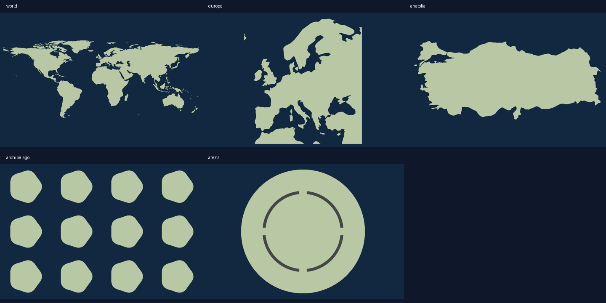

# Coğrafya, boyut ve denge düzenlemesi

Dünya ve Avrupa artık elle çizilmiş kıta benzetimlerinden değil, Natural Earth 1:110m kara poligonlarından üretilir. Türkiye 1:50m ülke poligonundan çizilir; Trakya ve Anadolu dahil, çevre ülkeler Türkiye toprağına eklenmez. Veri genelleştirilmiştir; sokak/şehir haritası hassasiyetinde değildir. Kıyılar rastgele tohumla değiştirilmez.

Kaynaklar:
- https://github.com/nvkelso/natural-earth-vector/blob/master/geojson/ne_110m_land.geojson
- https://github.com/nvkelso/natural-earth-vector/blob/master/geojson/ne_50m_admin_0_countries.geojson
- Lisans: kamu malı https://www.naturalearthdata.com/about/terms-of-use/

960×640 hücre, önceki 600×400 sürümden 2,56 kat fazla alan. Enlem/boylamın farklı mesafe ölçekleri dikkate alınarak en-boy oranı korunur. Coğrafi haritalara hayali dağ engelleri eklenmez. Coğrafi kara bölgelerinin eşit olması beklenmez; Arena rekabetçi simetri, Adalar yaklaşık eşit 12 ada sağlar.

Başlangıç toprakları bağlantılı 37 hücreye tamamlanır. 37 hücreyi desteklemeyen kopuk adacıklar başlangıç seçimine kapalıdır. En fazla 12 toplam oyuncu/bot; bot sayısı insan sayısına göre sınırlandırılır. Renkler tekrar kullanılmaz; tüm palet çiftlerinde CIELAB mesafesi 45'in üzerindedir. Bu ölçüm renk körlüğü erişilebilirliğini tek başına garanti etmez.

Mekanik düzeltmeleri: botlar nötr kara ve komşu düşman bulamadığında deniz seferi deneyebilir; insanlarla aynı saldırı kurallarını kullanır. Takımlar toplam %85 toprakla kazanabilir. Harita kenarındaki komşuluk hesabı satır atlamaz.

Doğrulama: 478 motor testi; coğrafi kara/deniz referans noktaları, Arena yansıma simetrisi, ada alan farkları, renk mesafeleri, 12 oyunculu başlangıç eşitliği, küçük ada filtresi, saldırı/çıkarma/oda/ücret testleri ve uzun simülasyonlar. Dört ekran boyutunda gerçek Socket.IO bağlantısıyla Chromium kontrolleri. Gerçek Android/iOS cihazı ve canlı dağıtım ayrıca doğrulanmamıştır.

