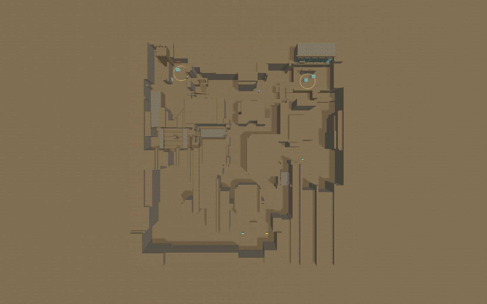
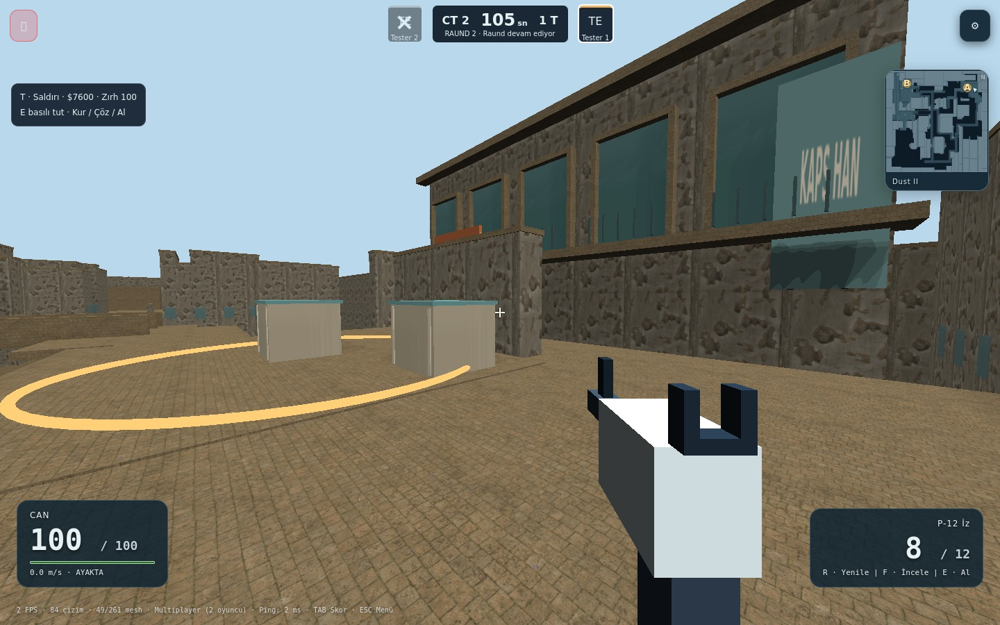
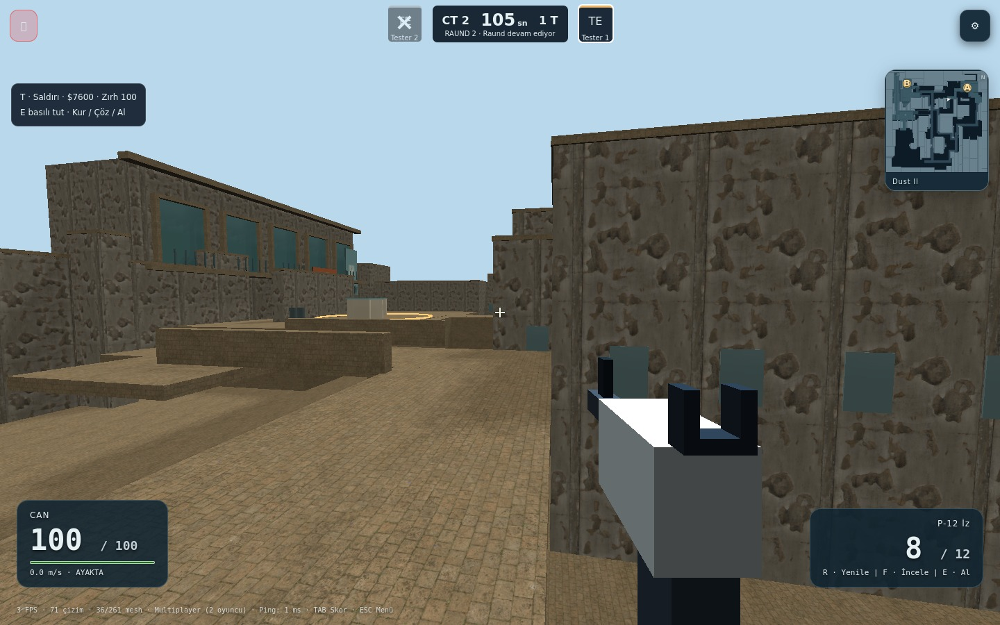
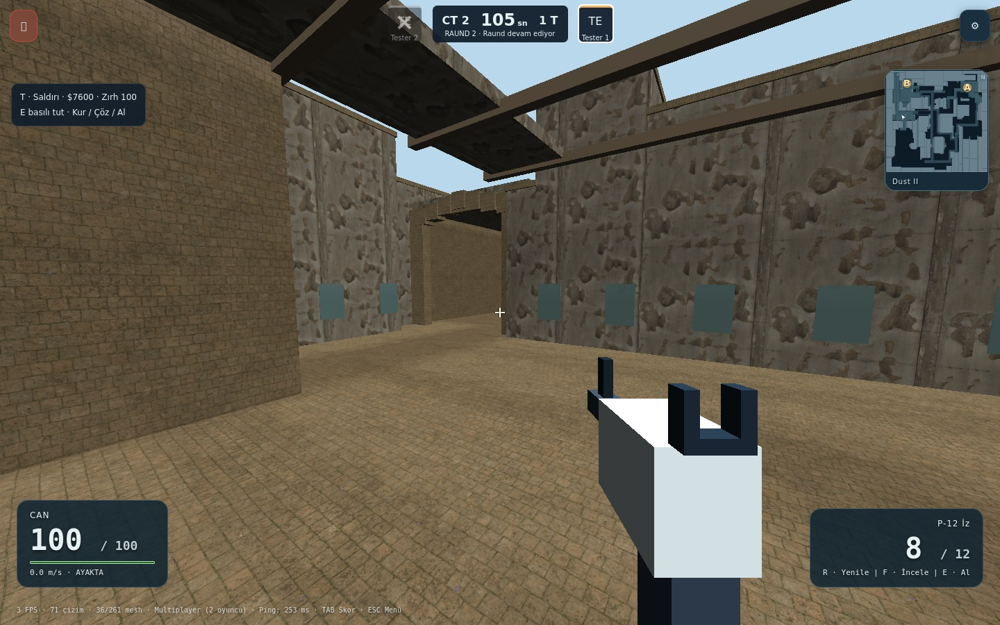
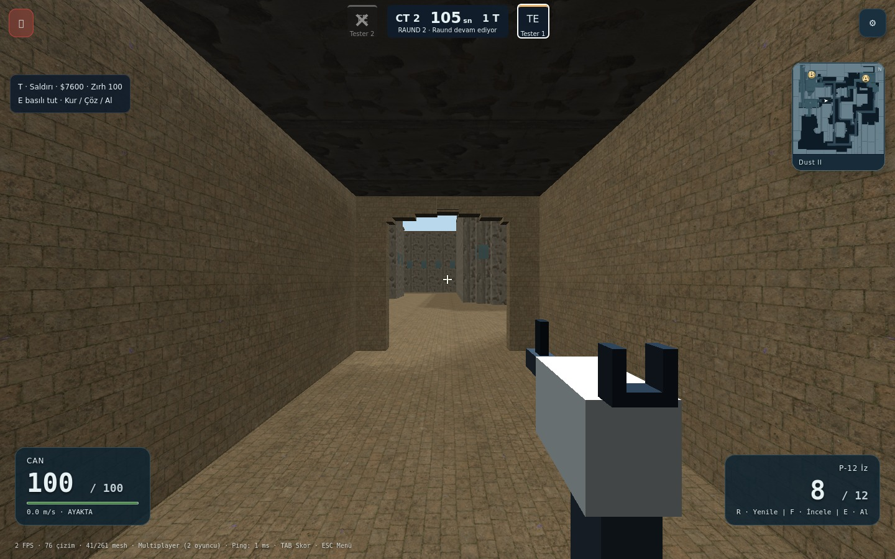
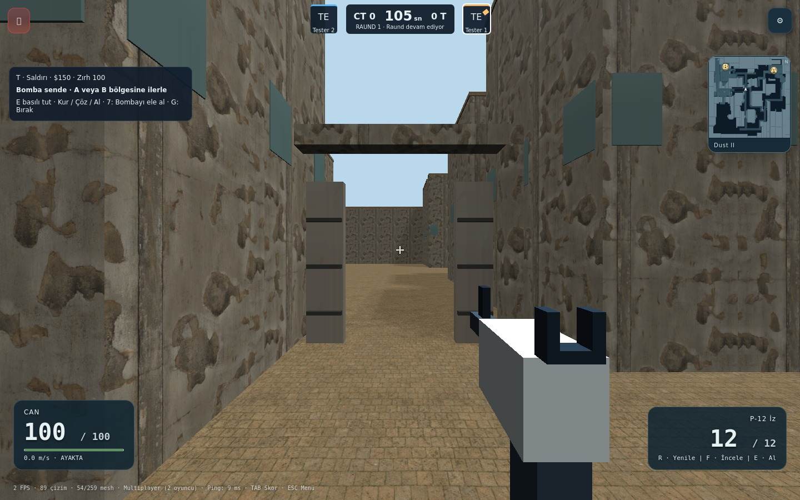
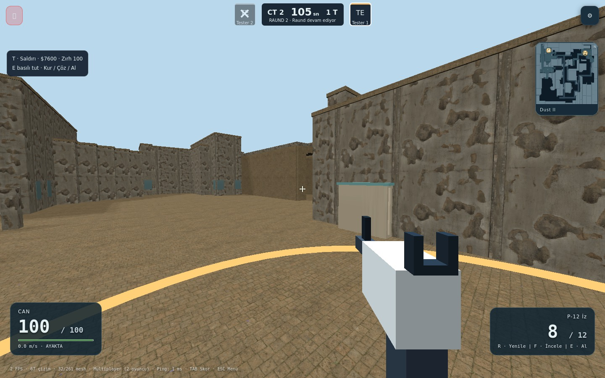
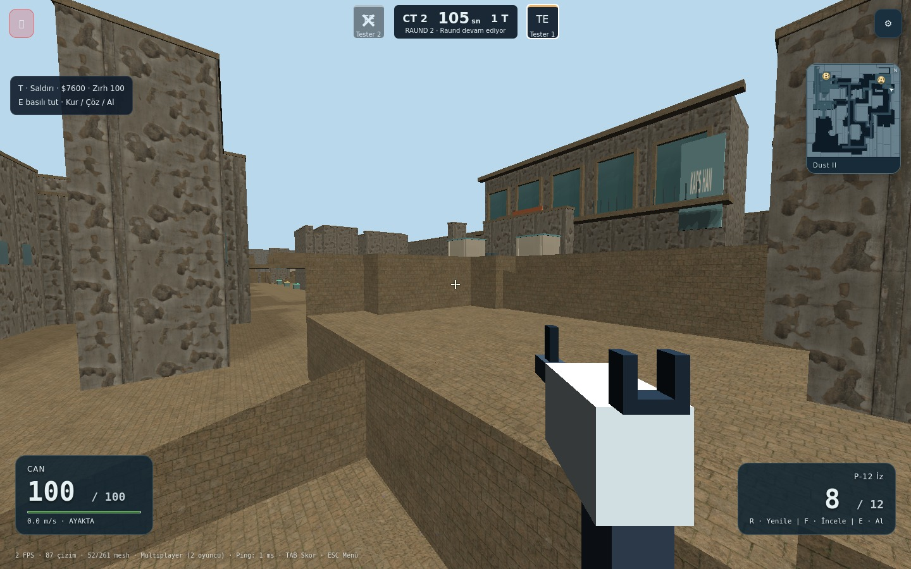
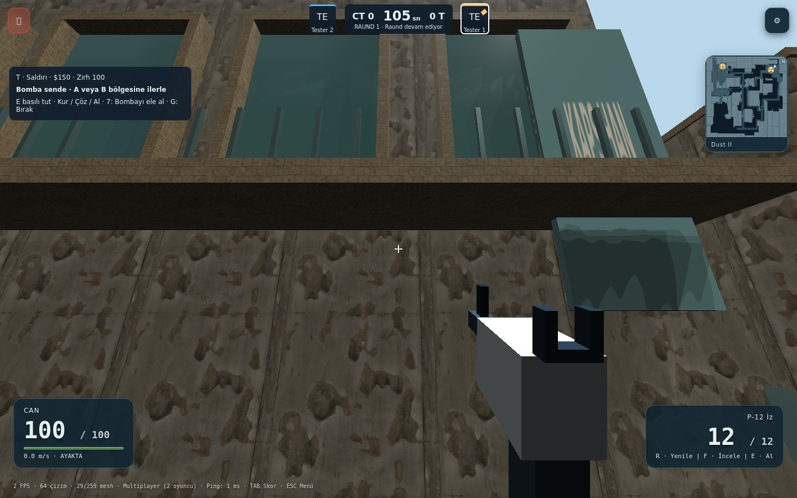

# Dust II 3D doğrulama — PR #10 devamı

Güncel devam/çakışma incelemesi: [1 Kasım devam raporu](continuation-2026-11-01.md). Aşağıdaki 230-test ve ekran görüntüsü kayıtları `ca49247` revizyonuna aittir.

## Uygulanan geometri

Önceki radar tabanlı yatay ayak izi korundu; bağımsız deneme rampaları kaldırıldı. Artık ortak istemci/sunucu geometrisinde:

- A platformu ve Catwalk 3,2 m; Upper/B tarafı 2,4 m; Lower Tunnels ve CT alt geçidi 0 m seviyesinde.
- Short merdivenleri, açılı Catwalk, iki parçalı dönüşlü A Ramp ve CT alt geçidi bağlandı. CT’den A Ramp’ın altına kısa, dar bir rotasyon koridoru açıldı.
- T tarafından Upper giriş rampası, Upper–Lower merdiven bağlantısı, tavanlı Lower/B Tunnels, Upper kirişleri ve kırık çatı parçaları oluşturuldu.
- A Long/Mid/B kapılarında gerçek açıklıklar; B Window'da basamak, eşik, yan duvar ve üst kiriş var.
- Özgün otel cephesi, balkon, kale silueti, pencereler, kapı çerçeveleri, kasalar, örtüler ve variller eklendi.
- Bombsite koordinatları ve dünya işaretleri yükseltilmiş zeminlerle eşitlendi. Ters eğimli rampanın fizik, çizim ve sunucu raycast denklemleri aynı.

Yükseklikler fotoğraflardan yapılan tasarım tahminleridir. Source 2 mesh'i veya kesin ölçülü 3D veri kullanılmadı. Bu çalışma birebir CS2 görsel/ölçü eşleşmesi olarak sunulmuyor.

## Referanslar

- Kullanıcının minimap ve bölge fotoğrafları: bu konuşmada verilen radar, Short/A/Tunnels fotoğrafları incelendi; oyun asset'i olarak kopyalanmadı.
- [CSBePro rota referansı](https://csbepro.com/counter-strike-2/dust-2/): erişildi, bölge/bağlantı kontrolünde kullanıldı; kesin 3D ölçü kabul edilmedi.
- [Valve Dust2 sanat referansı](https://www.counter-strike.net/dust2): erişildi; bu resmî sayfa eski CS:GO yenilemesini gösterir. A/B ve tünel fotoğrafları mimari referanstır, güncel CS2 ölçü verisi değildir.
- [Fandom galeri](https://counterstrike.fandom.com/wiki/Dust_II/Gallery): erişim kısıtı nedeniyle incelenemedi.
- [Worn Plaster Wall](https://polyhaven.com/a/worn_plaster_wall) ve [Stone Floor](https://polyhaven.com/a/stone_floor): CC0. High profilinde yerel 2048×2048 albedo, OpenGL normal ve roughness haritaları. Kaynak URL/MD5 değerleri `public/kapsstrike/materials/manifest.json` içinde. Low/Medium prosedürel kaplamaları kullanır.

## Gerçek test kapsamı

- `npm run lint`: TypeScript kontrolü başarılı.
- `npm run build`: Vite istemci, esbuild sunucu ve SEO derlemesi başarılı.
- `npm run test:strike`: 230/230 başarılı. Ortak fizik, 3D geçişler, rampalarda raycast, spawn/site rotaları, A–B arasında 56 farklı konum çiftinde görüş hattı engeli, silahlar, sunucu otoritesi ve kaynak temizliği dahil.
- `npm run test:strike:dust3d`: iki bağımsız Chromium oturumu, gerçek Socket.IO oyun sunucusu. T→A, T→B, CT→A, CT→B, Short/Catwalk, B Tunnels→B Site ve Upper→Lower→Mid ve kısa CT alt geçidi→A Ramp rotaları normal istemci hareket girdileriyle yüründü; sunucu son konumları doğrulandı.
- Bomba kurma/bırakma sonrası görünmez bomba seçiminin ateşi engellemesi düzeltildi; Lower Tunnels içinde iki tarayıcıyla atanmış H tuşundan gerçek ateş, hasar, ölüm ve skor denetlendi.
- A ve B'de ayrı kurma, CT kit ile çözme, skor ve sonraki raund doğrulandı; masaüstü pointer lock/ESC, tablet satın alma ve 390/768/844 px HUD yerleşimleri kontrol edildi.

Test kimlikleri ve ilk yerleştirmeler yalnız test düzeneğinde atanır. İlk satın alma penceresi, yürüyüş süresi ve görüntü pozu için sayaçlar kontrollüdür. Üretimde kimlik doğrulama veya hareket otoritesi atlanmaz. Görüntü alırken sunucu simülasyonu durdurulur ve kamera test pozlarına taşınır; bu pozlar yürüyüş kanıtı değildir. Yürüyüş kontrolü ayrı canlı simülasyon turundadır.

İlk denemelerde dar köşede test sürücüsünün sapması, tekrarlanan snapshot tick'i ve eşzamanlı yazılımsal GPU yükünde kısa bekleme süresi sorunları görüldü; test düzeneği düzeltildi. Playwright fare olayları pointer lock altında nişan hareketi oluşturduğundan çatışma testi özelleştirilebilir H ateş bağlamasını kullanır; bu sonuç sol fare düğmesiyle manuel oynanış testi olarak sunulmaz. Neon sandık engel testi, rastgele seçilen yükseltilmiş eşyanın önüne duvarı y=0'da koyuyordu; engel eşyanın yüksekliğine alındı ve hedef eşya izole edildi.

## Yeniden çalıştırma

```sh
npx playwright install chromium
npm run lint
npm run build
npm run test:strike
STRIKE_ROUTES_ONLY=1 npm run test:strike:dust3d
STRIKE_SCREENSHOTS_ONLY=1 npm run test:strike:dust3d
```

İlk tarayıcı komutu canlı rotaları ve iki istemcide rakip mesh'lerini denetler. İkincisi rota yürüyüşlerini atlar; gerçek kurma/çözme, klavye ateşiyle çatışma ve High görüntüleri üretir. `STRIKE_CAPTURE_ONLY=1` yalnız görsel kontrol yapar; bu modun çıktısı çatışma testi sayılmaz. `STRIKE_ROUTE_NAME` tek rotayı, `STRIKE_CAPTURE_VIEWS` virgülle ayrılmış kamera pozlarını seçebilir. [Gerçek sonuç özeti](verification.txt).

## Değiştirilen dosyalar

- `src/games/kapsstrike/dust2Architecture.ts`, `dustDistrict.ts`: mimari, yükseklikler, geçişler ve rota geometrisi.
- `physics.ts`, `types.ts`: ters eğimli rampanın destek/çarpışma/raycast tanımı.
- `bomb.ts`, `controller.ts`: yükseltilmiş kurma bölgeleri ve bomba sonrası silaha dönüş.
- `renderer.ts`, `surfaceTextures.ts`, `src/components/games/kapsstrike/StrikeMinimap.tsx`: PBR, UV yoğunluğu, ışık, hafif profiller ve radar katmanları.
- `public/kapsstrike/materials/*`: altı 2K kaplama, lisans ve kaynak manifest'i.
- `tests/kapsstrike.dust3d.*`, ilgili bomb/routes/world/test dosyaları, `package.json`: 3D hareket ve iki istemcili doğrulama.
- `docs/qa/dust2/*`: bu rapor, gerçek ekran görüntüleri ve sonuç özeti.

## Sınırlar

Gerçek iOS/Android cihazı, Safari ve donanımsal GPU üzerinde FPS/bellek ölçümü yapılmadı. Headless Chromium SwiftShader kullanır; ekrandaki düşük FPS donanımsal masaüstü performans ölçümü değildir. Görünüm hâlâ KapsStrike'ın stilize geometrisidir; CS2 düzeyinde fotogerçekçi modeller veya birebir ölçü doğruluğu tamamlanmış sayılmamalıdır. Silah/skin sisteminin mevcut modelleri korunmuştur. Main'e birleştirme veya canlı deploy yapılmadı.

## Gerçek High oyun görüntüleri

Üstten görünüşte yalnız inceleme için sis, HUD ve eldeki silah gizlenir; diğerleri gerçek oyuncu kamerasıdır. Görüntüler oluşturulmuş tanıtım resmi değildir.










