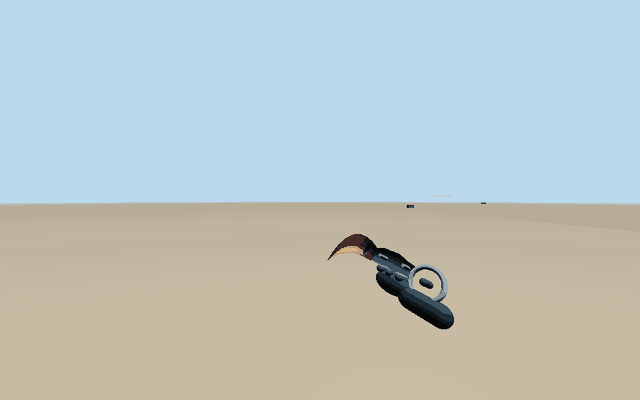
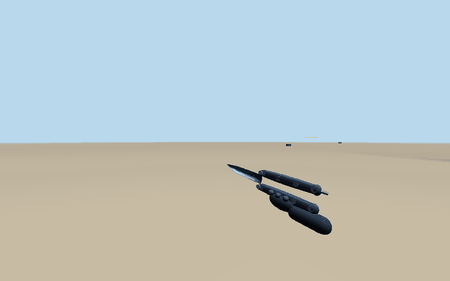

# KapsStrike — atış kaydı ve bıçak düzeltmeleri (1 Kasım 2026)

Başlangıç: main `9984cda`. Önceki PR #10 bu çalışmadan önce birleştirilmişti; main'deki sonraki silah/skin/envanter geliştirmeleri korunarak `fix/strike-hitreg-knife-motion` dalında devam edildi. Haritalar yeniden oluşturulmadı. Main/deployment bu çalışma tarafından değiştirilmez.

## Ölçülmüş kök nedenler ve değişiklikler

1. **Seyrek giriş teslimi sırasında otomatik ateş kesiliyordu.** Sunucu aradaki sabit fizik adımlarında `fire:false` üretiyordu. Kontrollü aynı 1 saniyelik/30 girişli ölçümde SMG eski kodda **13**, düzeltmede **15** atış işledi. Artık otomatik tetik kısa ve ping ile sınırlı bir süre korunur; bağlantı/giriş kesilince süresiz ateş edilmez. Fizik 120 Hz, dış zamanlayıcı 60 Hz, snapshot 30 Hz olarak korundu.
2. **Rewind zamanı ekranda görülen hedefe ait değildi.** Yerel tahmin tick'i, 70–150 ms gecikmeli çizilen rakibin zamanını temsil etmiyordu. İstemci artık çizdiği snapshot aralığının kesirli `viewTick` değerini gönderir. Sunucu RTT/enterpolasyon/kuyruk sınırları içinde konum, yaw ve pitch geçmişini enterpole eder; teleport/ölüm üzerinden enterpolasyon yapılmaz. 500 ms'den eski veya makul aralığın ilerisindeki modern atış zamanı reddedilir. Aynı hareketli hedef teşhisinde eski kod **0**, yeni kod **17,4878** hasar verdi. Bu bir kontrol senaryosudur, bütün maçlar için genel isabet oranı iddiası değildir.
3. **Tam şarjör sonunda tahmin–otorite farkı gerçek tarayıcı testinde görüldü.** 150 ms tek yön gecikmede istemci 0 mermi gösterirken sunucu 29 atış/1 mermi durumunda kalabiliyordu. Erken gelen tahmin edilmiş atış niyeti en fazla iki atış ve 300 ms ile sınırlandırılmış tamponda tutulur. Ateş aralığı dolduğunda, tetik bırakılmış olsa da zaten istenmiş son atış özgün nişanıyla işlenebilir. RPM, mühimmat, ölüm, silah değiştirme ve raund kısıtları geçerlidir. Son şarjör mermisi için bağımsız regresyon testi eklendi.
4. **Görünür gövde ile hitbox yönü farklıydı; kollar vurulabilir değildi.** Gövde bölgeleri, boyun, kollar ve baş aynı görünür ölçülerle izlenir. Torso yaw, baş pitch ve crouch yüksekliği ray dönüşümüne katılır. Gövde devasa bir kutuya büyütülmedi; mevcut gövde hacmi bantlara ayrıldı ve görünen kola/bağlantı boynuna karşılık gelen hacimler eklendi. Kozmetik aksesuarlar ekstra zırh değildir.
5. **Yuvarlak kapakların görünmez köşeleri mermiyi kesebiliyordu.** Silindir varillerin ve konilerin raycast'i bounding box yerine renderer'daki aynı 12/8 kenarlı yüzeylere uyarlandı. Gerçek kutu ve duvar engelleri korunur. Rampa ve kapı testleri mevcut geometri üzerinde geçerlidir.
6. **İsabet bildirimi gecikince eski tick nedeniyle çok erken kaybolabiliyordu.** Hitmarker'ın görünürlük süresi teslim anındaki yerel tick'ten başlar. Kendi sunucu onayından gerçek hasar gösterilir; snapshot ile gelen aynı hit ikinci kez ses/hasar eklemez. Tahmin edilmiş ateş sesi/recoil ile sunucu hit onayı ayrıdır. Client/server spread hesabı artık aynı fonksiyondan gelir; hasarlar veya spread sıfırlanmadı, silah dengesi rastgele yükseltilmedi.

## Teşhis ve yetki

- Kabul edilen her atışın tekil sunucu `shotId` değeri, giriş sequence'i, tahmin indeks bağlantısı, silahı, receive/process zamanı, kuyruk süresi, sonucu ve gerçek hasarı yalnız atıcısına onaylanır. Geçersiz/tekrarlı/dolu kuyruk atış talepleri sebebiyle bildirilir. Cooldown nedeniyle tamponlanan talep ile gerçekten reddedilen talep ayrılır; tekrar tahmin edilen bazı cooldown talepleri hâlâ reddedilebilir. Bunlar sayısal sonuçlarda gizlenmez.
- `STRIKE_COMBAT_DEBUG=1` ve üretim dışı sunucu ayarı ile 256 kayıtlık, sınırlandırılmış geliştirici tamponu: origin, yön, spread seed, rewind tick, hedef pozu, bölge, dünya engeli ve pellet bazında zırh öncesi/sonrası hasar. Normal snapshot'lara geçmiş rakip pozları eklenmez.
- Vite geliştirme modunda `showDebugStats` açıksa cyan çizilen hitbox, turuncu geri sarılmış hitbox ve gerçek sunucu ışınları gösterilir. Üretim derlemesinde bu overlay açılmaz; sunucu debug'u istemci isteğiyle etkinleştirilmez.
- Sunucu RTT'si artık istemcinin duvar saatinden çıkarılmaz; sunucunun başlattığı challenge–ack süresi kullanılır. Bu sorgular yalnız aktif Strike odasında çalışır.
- Socket.IO/WebSocket teslim gecikmesi otomatik olarak “UDP paket kaybı” diye sınıflandırılmaz. Bu çalışmada gerçek WAN paket kaybı ölçülmedi.

## Karambit ve kelebek

- **Karambit:** kapalı, incelen, pahlanmış kavisli bıçak; bölümlerle biçimlendirilmiş ergonomik kabza; gerçek delikli halka ve bağlantı; eldivenli tutuş. Döndürme silahın merkezinde değil sabit işaret parmağı/halkası ekseninde gerçekleşir. Yürüme/idle salınımı ve yumuşak bilek hareketi eklendi.
- **Kelebek:** safe sap, bıçak/tang ve bite sap için ayrı TransformNode hiyerarşisi ve birbirinden ayrık paralel pim eksenleri. Sap rayları, ara pimler, yuvarlak uç ve mandal komple kendi menteşeleriyle döner; siyah boyalı “delik” kutuları yerine açık kanallar kullanılır. Bıçak da açılış/inspect hareketine katılır. İnceleme bitince eklemler açık tutuşa yerleşir.
- Ateşli silahların görünümleri ve mevcut skin renk/desenleri korunur. Bıçaklar özgün stilize oyun modelleridir; CS2'den alınmış fotogerçekçi asset değildir.

| Karambit — 48 gerçek render karesi | Kelebek — 48 gerçek render karesi |
|---|---|
|  |  |

GIF'ler gerçek renderer'dan 2,4 saniyelik inspect pozu örnekleridir. 20 FPS önizleme oynatımı, ölçülmüş cihaz FPS'si değildir. Kamera/ışık test sahnesine aittir.

## Doğrulama

**251/251 otomatik test, lint ve build başarılı.** [Son komut/CPU özeti](verification.txt). 10 eşzamanlı atıcıda 600 kabul; bu makinede ortalama adım 0,336 ms, p95 1,656 ms olarak ölçüldü.

- Gerçek iki bağımsız WebGL/Chromium oturumu, normal `StrikeController` → Socket.IO → otoriter sunucu → raycast → hasar → onay hattı.
- 2/5/10/20/40 m: **100 tekli tabanca atışı, 100 kabul, 100 hasarlı isabet**, normal reload dahil.
- Rifle/SMG/carbine/LMG, her biri 0/30/60/100/150/200 ms ek **tek yönlü** gecikme ve 0/7 ms jitter: **24 tam şarjör**, şarjör kapasitesi ile sunucu kabul sayısı eşit. Tam şarjörler toplam **894** kabul edilmiş atış; bu kontrollü 5 m ADS sahnesinde tamamı hasarlı isabet. Buffer/reject sayıları ham JSON'da ayrıca verilir.
- Sağa/sola/çapraz hareket, crouch ve jump: 0/100/200 ms tek yönlü gecikmede **15 hareketli hedef senaryosu** geçti. Nişan sunucunun güncel pozuna değil istemcinin çizdiği rakip modeline yöneltildi.
- Ayrı 100 HP 1v1: ölüm, kill feed ve skor bir kez işlendi. Ayrı headshot: gerçek hasar ve sunucu onaylı headshot işareti geçti.
- Sekiz ateşli silahın tamamı 5 m / 100 HP gövde TTK senaryosunda gerçek iki tarayıcıyla denendi. Rifle, SMG, carbine, LMG, pistol, sniper, shotgun ve railgun. [Tarayıcı ölçümleri](weapons-results.json).
- Bomba regresyonu: create/join/ready/start, masaüstü pointer-lock B/ESC, armor/kit satın alma, telefon taşma kontrolü, A kurma/kit çözme, skor ve sonraki raund geçti. İki bağımsız Chromium istemcisi, gerçek sunucu; ilk pozlar/satın alma sayacı fixture kontrollüdür.
- Bütün silahların 30/60/120/144 FPS adım gruplamasında fire rate/mühimmat eşitliği, deterministic direction, history/dupe/son mermi/spawn/map occlusion testleri. Bu bir simülasyon testidir; gerçek 144 FPS GPU ölçümü değildir.
- 8/10 gerçek socket istemcili mevcut gecikme/jitter, session replacement, reconnect ve host transfer testleri de çalıştırıldı. Ayrı 10 eşzamanlı otomatik atıcı testi: 600 kabul, 600 mermi tüketimi; geçmiş/kuyruk sınırları korundu. CPU değerleri aynı makinedeki test ölçümüdür.

Atış yanıt gecikmesi: karma gecikmeli ana koşuda son 128 yanıtın ortalaması **188.11 ms**; ek gecikmesiz sekiz silah koşusunda 30 yanıtın ortalaması **39.31 ms**. Bunlar sınırlı istemci yanıt tamponu ölçümleridir; tüm maçların ortalaması veya gerçek WAN ping'i değildir.

### 5 m kontrol sahnesinde hasar/TTK

Aşağıdaki değerler sunucu kontrol düzeneğinden, ADS ile sabit gövde hedefine ölçülmüştür. Süre ilk kabul edilen atıştan öldüren atışa kadardır; giriş gecikmesi ve tepki süresi dahil değildir. 0 ms tek atışta ölüm anlamındadır. Sunucu hasar/armor parametreleri korunmuştur.

| Silah | Zırhsız: isabet / süre | 100 zırh: isabet / süre |
|---|---:|---:|
| rifle | 5 / 392 ms | 7 / 592 ms |
| smg | 6 / 350 ms | 9 / 558 ms |
| carbine | 4 / 325 ms | 5 / 442 ms |
| lmg | 4 / 267 ms | 6 / 450 ms |
| pistol | 4 / 492 ms | 6 / 825 ms |
| sniper | 2 / 1192 ms | 2 / 1192 ms |
| shotgun | 2 / 792 ms | 3 / 1592 ms |
| railgun | 1 / 0 ms | 2 / 1492 ms |

[Önce](before.json) · [Sonra](after.json) · [44 tarayıcı senaryosu](browser-results.json) · [Headshot](headshot-results.json) · [Komut çıktıları](browser-verification.txt)

## Sınırlar / henüz kanıtlanmayanlar

Gerçek iOS/Android/Safari, donanımsal GPU FPS/belleği, gerçek WAN paket kaybı, bütün silahlarla her mesafede 20 tekli/burst/spray matrisinin tamamı, insan kontrollü 2v2 tam maç ve bütün overtime maç döngüleri bu raporda geçmiş sayılmaz. Browser fire-rate/hasar testi seçili matrislerdedir; 30/60/120/144 FPS eşitliği sabit adımlı simülasyonda doğrulandı. Hareket/stress menzilleri engelleri yalnız test fixture'ında kaldırılmış tanılama sahneleridir; üretim haritaları korunur ve occlusion ayrıca gerçek geometri testlerinde denetlenir. Büyük HP'li hedefler dağılım testlerinde kullanıldı; TTK/ölüm testleri ayrı 100 HP hedeflerle yapıldı.

İlk denemelerde uzun otomatik tetik darbelerinin “tekli” diye sayılması, reload tamamlanmadan yapılan test girdisi, sıcak kaynak düzenlemesiyle fixture'ın yeniden yüklenmesi ve 100 değerinin kayan nokta toplamında 99,99999999999999 çıkması gibi test düzeneği sorunları görüldü. Son mermi 29/30 problemi ise üretim davranışında yeniden üretildi ve ayrı regresyon ile düzeltildi. Başarısız çalıştırmalar başarılı sonuç gibi sayılmaz.

## Tekrar çalıştırma

```sh
npm run lint
npm run build
npm run test:strike
npm run test:strike:hitreg
npm run test:strike:bomb:browser
STRIKE_CASES=head npm run test:strike:hitreg
STRIKE_CASES=weapons npm run test:strike:hitreg
STRIKE_KNIFE_FRAMES=48 npm run test:strike:knives
npm run test:strike:measure
```

Sonuçları `STRIKE_QA_OUTPUT` ile ayrı dizine yönlendirebilirsin. Test sunucularındaki test kimliği/yerleştirme kodları üretim kimlik doğrulamasını atlamaz; bu fixture rotaları üretim sunucusunda kayıtlı değildir.

## Değiştirilen ana dosyalar

- `src/games/kapsstrike/knifeRig.ts`, `renderer.ts`: yeni bıçak geometrileri, menteşeler, halka pivotu, eldiven/tutuş, inspect/deploy/idle pozları.
- `hitboxes.ts`, `character.ts`, `physics.ts`: yön/stance ile uyumlu bölgeler, görünür boyun ve şekle uyan engel raycast'i.
- `combat.ts`, `controller.ts`, `types.ts`: ortak spread, görüntülenen tick, predicted shot korelasyonu, sunucu onayı ve hitmarker yaşam süresi.
- `combatDebug.ts`, `src/server/kapsstrikeServer.ts`: geliştirici overlay/kayıtları, geçmiş enterpolasyonu, RTT, sınırlı tetik/son mermi tamponu ve atış muhasebesi.
- `tests/kapsstrike.hitreg.*`, `tests/kapsstrike.knife.*`, `tests/kapsstrike.multiplayer.test.ts`, `package.json`: ölçümler, gerçek tarayıcı testleri, regresyonlar ve komutlar.
- `docs/qa/gunplay/*`: gerçek GIF'ler, öncesi/sonrası JSON, tarayıcı ve test kayıtları.
