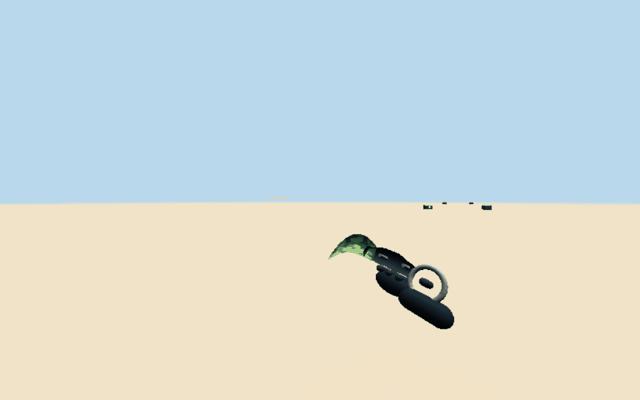
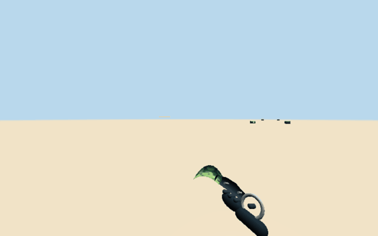
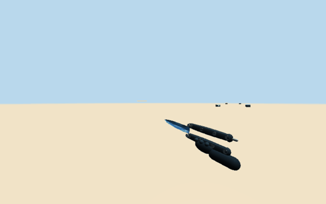
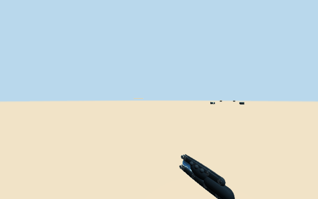
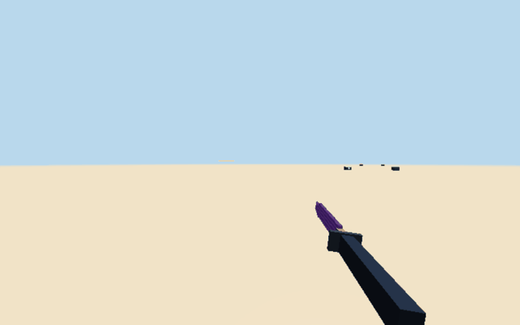
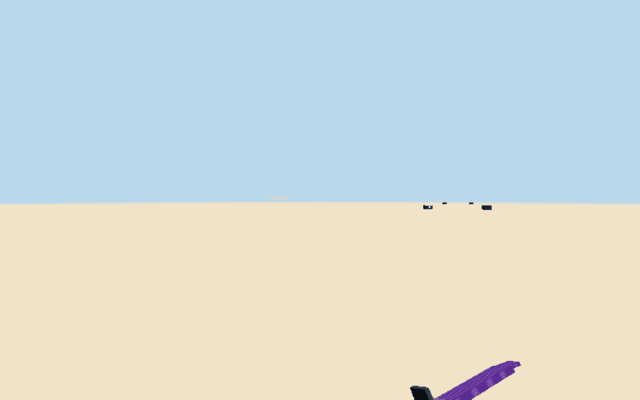
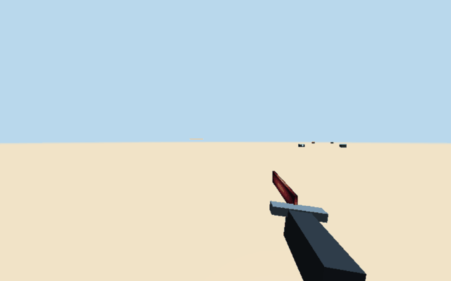
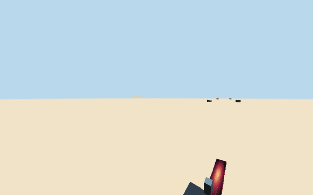
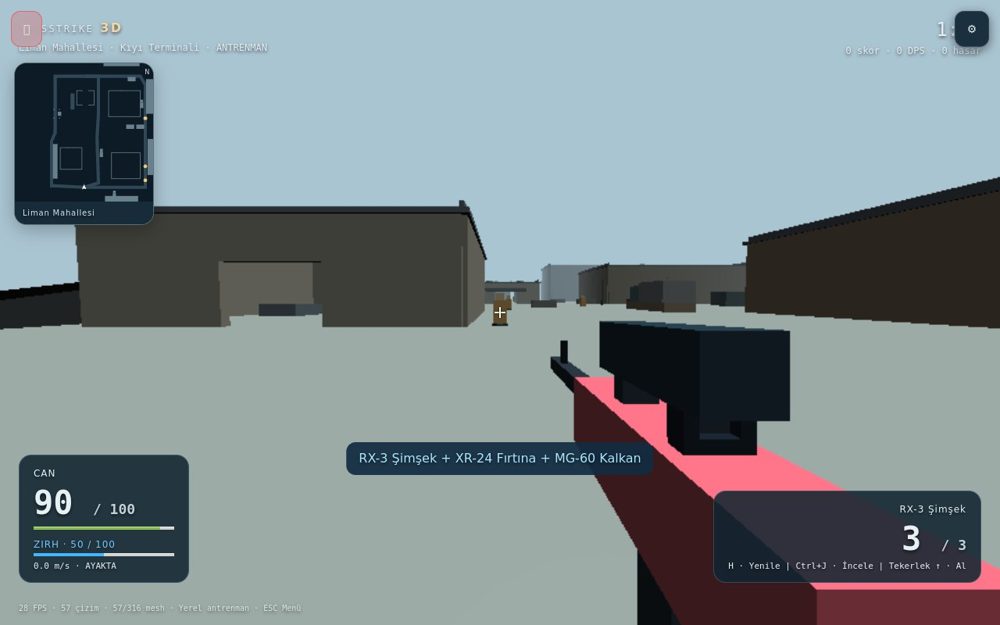
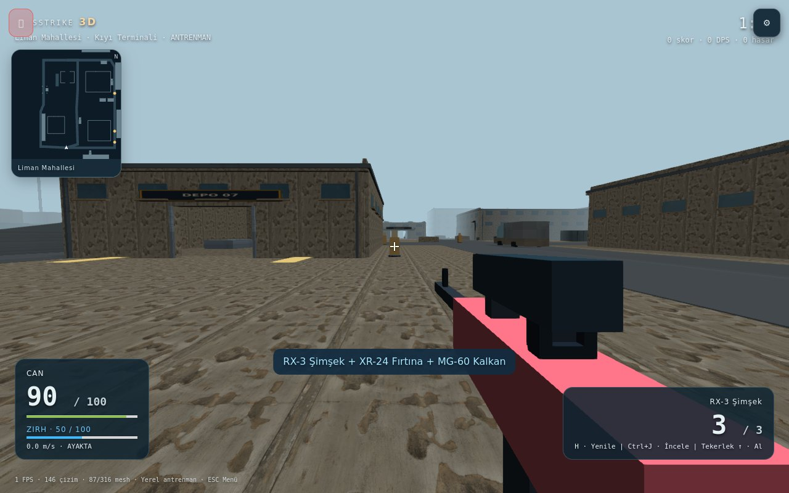

# KapsStrike — hızlı bıçaklar, loot, kontroller ve grafik profilleri

2026-11-01. Başlangıç: `main@07163f967e06b2e1148f1ecde55aad6a7f9378e4` (PR #11 birleşmesi). Önceki Dust II, bomba ve hit registration çalışmaları korunmuştur. Bu çalışma taslak PR içindir; merge veya deployment yapılmadı.

## Davranış

| İstek | Uygulanan davranış |
| --- | --- |
| Karambit / kelebek hızları | İnceleme 2,40 → 0,65 sn (3,69×); döndürerek ele alma 0,65 → 0,18 sn (3,61×). Önceki geometrinin parmak halkası / bıçak ve iki menteşeli kelebek mekanizması korunur. |
| Diğer bıçaklar | Tanto için kesici yüzeyi inceleme ve bilek çevirme, savaş bıçağı için tam bilek turu; özel çekiş hareketleri. İnceleme 0,95 sn, çekiş 0,28 sn. |
| Skin | Dört bıçak biçiminin her birine dört finish: Orman Kamuflajı, Buzul Akımı, Mor Yıldırım, Kızıl Süpernova. 16 yeni varyant, eski üç skin ve envanter kimlikleri korunur. Kasaların toplam bıçak olasılığı %5 kalır. |
| Deathmatch kutuları | Haritalarda üç silah kutusuna ek olarak yeşil +50 can ve mavi +50 zırh kutusu. Her ikisi 100 ile sınırlı; doluyken kutu tüketilmez. Zırh önce hasarı emer, sonra can azalır. Ölüm/yeniden doğuşta zırh sıfırlanır. |
| Airdrop | Tek açışta RX-3 Şimşek + XR-24 Fırtına + MG-60 Kalkan, dolu şarjörleriyle envantere girer. Drop, açılmamış kutuların üzerine inmez. |
| Tuş atama | Yakalama sırasında ESC ayar penceresini kapatmadan iptal eder; Tab menü kısayoluna takılmaz. Klavye, değiştirici, fare ve tekerlek atamaları çalışır. HUD mevcut atamayı gösterir. |
| Düşük | Yüzey dokuları, PBR, gölgeler, FXAA ve çevre süsleri kapalı. DPR en fazla 1; temel piksel ölçeği 0,8; daha az iz/çarpma/duman efekti. Çarpışma ve oynanış geometrisi korunur. |
| Yüksek | Paylaşılan altı gerçek 2048×2048 albedo/normal/roughness haritası; taş/duvar PBR, 16× anizotropi, 2048 px gölge ve FXAA. Yüksekten düşüğe geçişte PBR kaynakları serbest bırakılır. |

## Gerçek renderer kayıtları

Aşağıdaki GIF'ler üretim renderer'ından alınmıştır. Fixture yalnızca başlangıç pozu, seçili skin ve animasyon zamanı sağlar; bıçaklar veya kareler yapay görsel üretimi değildir. Hızlı incelemeler 32 kare × 20 ms ≈ 0,64 sn; hızlı çekişler 9 × 20 ms = 0,18 sn. Diğer incelemeler 32 × 30 ms ≈ 0,96 sn; çekişler 14 × 20 ms = 0,28 sn. GIF biçiminin zaman hassasiyeti nedeniyle yaklaşık sürelerdir.

| Bıçak / yeni skin | İnceleme | Ele alma |
| --- | --- | --- |
| Karambit / Orman |  |  |
| Kelebek / Buzul |  |  |
| Tanto / Mor |  |  |
| Savaş bıçağı / Kızıl |  |  |

### Aynı konumda grafik profilleri

Düşük:

Yüksek:

Ekrandaki H, Ctrl+J ve Tekerlek ↑ ipuçları testte yeniden atanan gerçek tuşlardır. Can 90, zırh 50; orta bildirim üç silahın birlikte alındığını gösterir.

## Doğrulama

- `npm run test:strike`: **258/258**, sıfır başarısız / atlanan test. [Tam çıktı](tests.txt).
- `npm run lint`: başarılı. [Çıktı](lint.txt).
- `npm run build`: başarılı. [Çıktı](build.txt).
- `npm run test:strike:features`: gerçek oyun arayüzünde tuş değiştirme → sayfa yenileme → hareket/şarjör; ESC iptali; Ctrl+J inceleme; sağ fare ateş; tekerlekle can, zırh ve üç silah; Low → High → Low kaynak kontrolü. [Çıktı](browser.txt), [grafik ölçümleri](quality.json).
- `STRIKE_CASES=loot npm run test:strike:hitreg`: iki bağımsız WebGL istemcisi / Socket.IO sunucusu; can/zırh kutuları, doğrulanan zırh isabeti ve zırh tükenince can kaybı; sunucu otoriteli üç silahlı drop. [Çıktı](network.txt).
- `node --import tsx tests/kapsstrike.features.animations.ts`: dört bıçak geometrisi / dört yeni skin ve çekiş-inceleme kareleri, sıfır sayfa hatası. [Çıktı](animations.txt), [kayıt listesi](captures.json).

Tarayıcı testleri headless Chromium / SwiftShader ile çalışır; başlangıç konumları ve test can değerleri fixture tarafından ayarlanır, ödüller gerçek controller etkileşimi ve sunucu yolundan alınır. Grafik ekranlarındaki FPS sayıları yazılımsal GPU ortamına aittir; gerçek cihaz performans kıyaslaması değildir. Gerçek iOS/Android/Safari FPS ölçümü yapılmadı. İlk yüksek profil geçişi shader/doku hazırlığı ister; yazılımsal test ortamında bu nedenle 120 sn işlem süresi sınırı kullanılır. Görünüm stilizedir, fotogerçekçilik iddiası yoktur.
