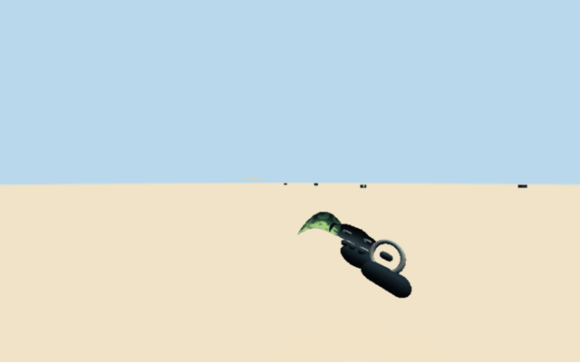
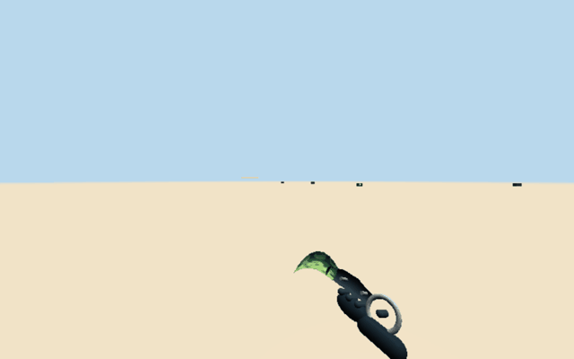
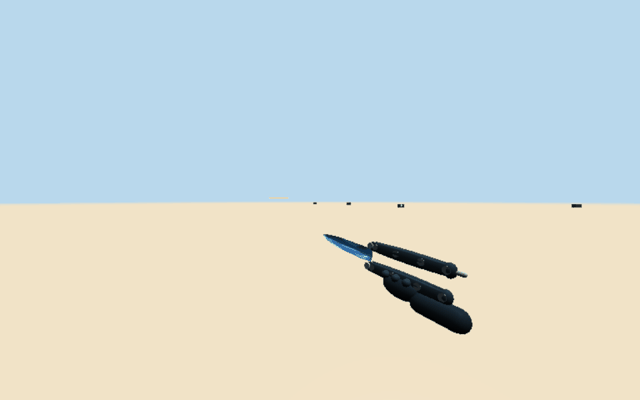
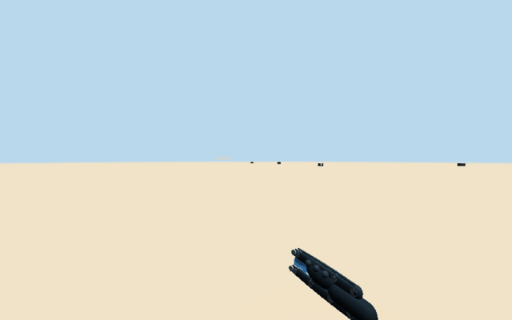
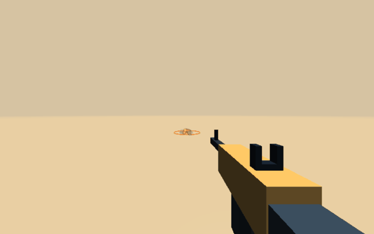
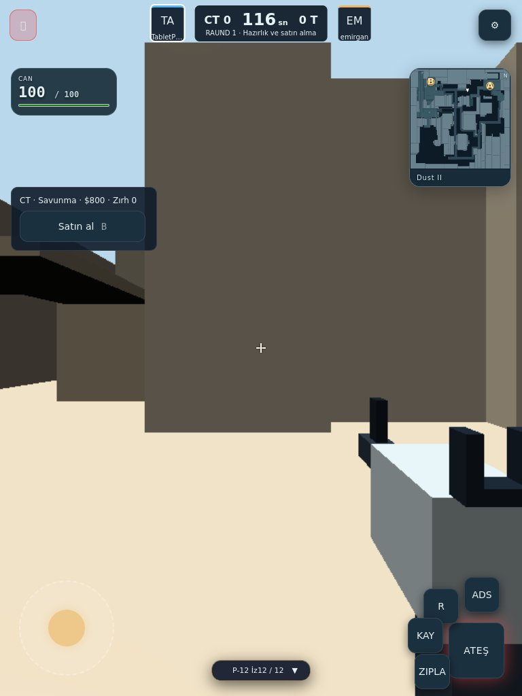
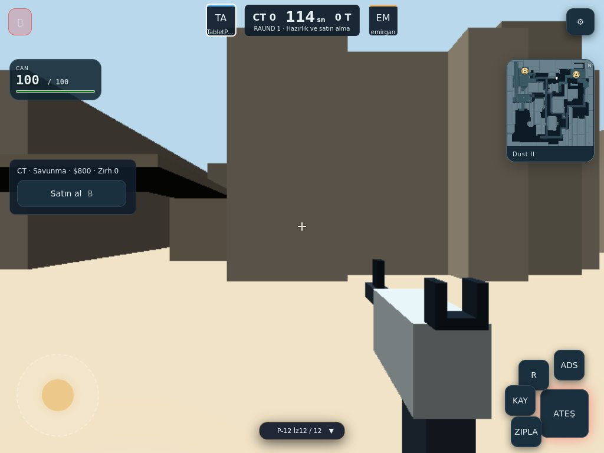
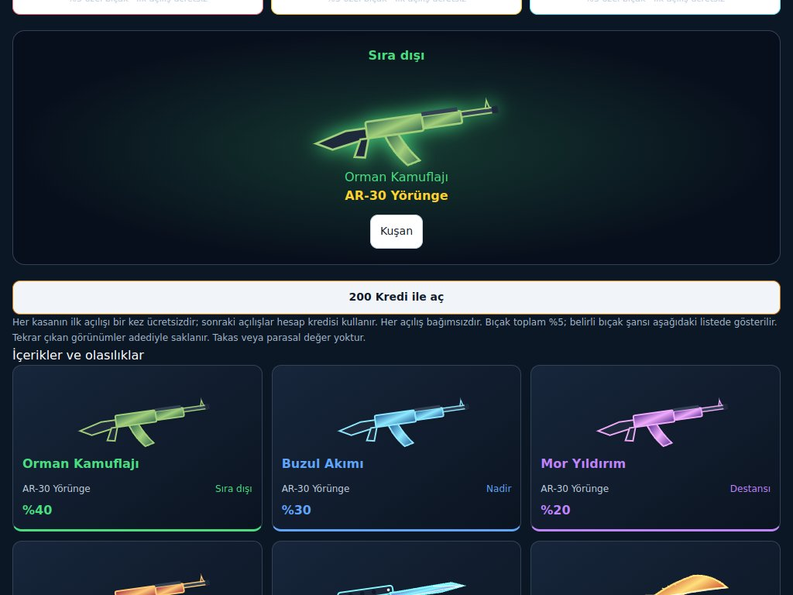
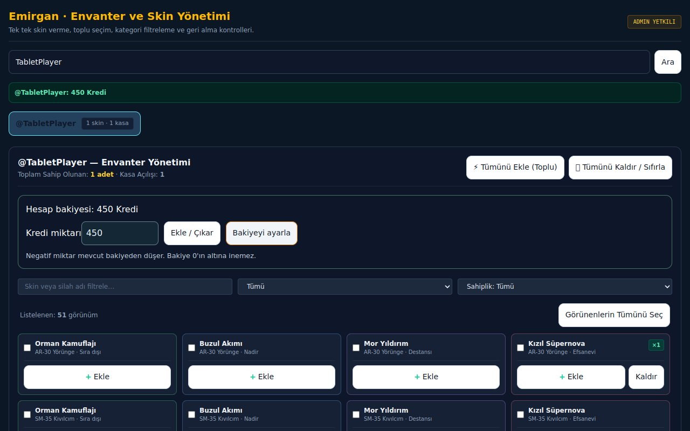
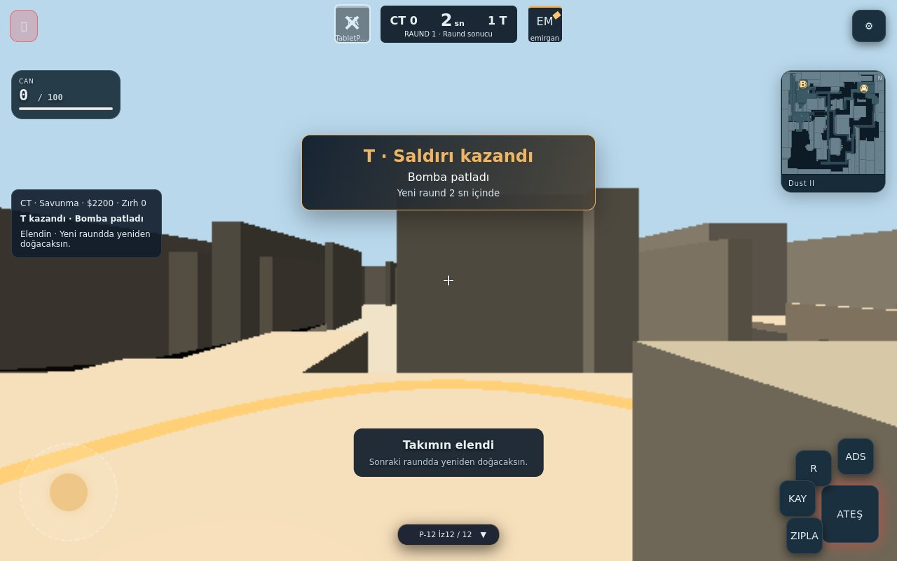

# KapsStrike — tablet, hesap kredisi, bıçak temposu ve bomba sonucu

2026-11-01. Güncel `main@d9da7daa421bd8b7fd490c6141705ad2ea99a609` üzerinden devam edildi. PR #12'nin birleşmiş olduğu doğrulandı. Önceki Dust II, bomba, hit registration, skin, grafik ve loot çalışmaları korunur. Bu PR taslaktır; merge veya deployment yapılmadı.

## Son davranış

- Karambit ve kelebek çekişi **0,18 → 0,24 saniye**: açısal hız %25 azalır. İnceleme **0,65 → 2,60 saniye**, üç tam döndürme/kelebek hareketi içerir. Diğer bıçaklar korunur.
- Dokunmatik aim assist: görünür, canlı rakibin gövdesine yaklaşık 3,7° yakınlıkta kaydırma %28 yavaşlar. 35 m sınırı vardır. Duvar arkası, takım arkadaşı, ölü hedef, fare, jiroskop ve bıçakta devreye girmez. Otomatik nişan/ateş yoktur. Ayarı kapatma tercihi kaydedilir.
- Tablet HUD'u seçili kontrol moduna göre yerleşir; iPad'in masaüstü kullanıcı aracısına da uygulanır. Can, radar, silah kartı, joystick, ateş ve bomba etkileşimleri ekrana sığar ve birbiriyle çakışmaz. Satın alma/ayar/hesap ekranları kaydırılabilir; klavye düzenine geçiş korunur.
- Hesap kredisi: sunucunun doğruladığı **kill +20**, kazanılan **bomba raundu +100**. Antrenman kazandırmaz. Bomba modunun raund içi silah satın alma parası ayrıdır.
- Altı kasanın **her biri için ilk açılış ayrı ayrı ücretsizdir**. Sonrakiler aşağıdaki fiyatları kullanır. Bakiye, hak tüketimi ve kozmetik ödülü tek veritabanı işlemiyle yazılır. Aynı kill/raund ödülü yeniden işlense bile ikinci kez eklenmez. Eski skinler, kuşanımlar ve açılış sayıları korunur; yeni sistemde her kasa için bir ücretsiz hak tanımlanır.
- Emirgan panelinde kullanıcı bakiyesi görüntüleme, ekleme/çıkarma ve doğrudan ayarlama bulunur. Yetki sunucuda doğrulanmış veritabanı hesabıyla denetlenir. Normal kullanıcının para değiştirme RPC'si reddedilir; kredi kazanma RPC'si sunulmaz.
- Bomba: genişleyen şok halkası, yumuşak kenarlı ateş/duman ve mesafeye bağlı kısa kamera sarsıntısı. **18 m yarıçaplı 3D alandaki her iki takım oyuncuları ölür**; zırh veya duvar koruması uygulanmaz. Sarsıntı kamera sunumuna uygulanır, oynanış nişanını değiştirmez. Efekt havuzu sınırlıdır ve düşük ayarda daha az duman gösterir.
- Tur sonucu sırasında hayatta kalanlar hareket edebilir; yeni raundun satın alma evresi mevcut kurallarını korur. Sonuçta ateş/etkileşim kapalıdır. Kazanan T için altın, CT için mavi duyuru yeni raunda kadar kalır.
- Deathmatch airdrop'u artık RX-3 / XR-24 / MG-60 arasından **bir silah** verir. Her seferinde üç silahın tamamını verme davranışı kaldırıldı; can/zırh kutuları korunur.

| Kasa | İlk açılış | Sonraki açılış |
| --- | --- | --- |
| Cephe | Ücretsiz | 200 Kredi |
| Hız | Ücretsiz | 250 Kredi |
| Ufuk | Ücretsiz | 300 Kredi |
| Kuşatma | Ücretsiz | 250 Kredi |
| Düello | Ücretsiz | 200 Kredi |
| Arsenal | Ücretsiz | 400 Kredi |

Krediler yalnızca oyunla kazanılan kozmetik hesabıdır; gerçek para alımı/çekimi eklenmedi. Bıçak toplam olasılığı %5 olarak korunur.

## Gerçek renderer kayıtları

Aşağıdaki kayıtlar üretim renderer'ından, kontrollü başlangıç pozları ve animasyon zamanlarıyla alınmıştır. Yapay görsel üretimi kullanılmadı. İnceleme 65 × 40 ms = 2,60 sn; çekiş 12 × 20 ms = 0,24 sn; patlama 60 × 50 ms = 3 sn. GIF toplam süreleri ayrıca okunarak doğrulandı.

| Bıçak | Uzun inceleme | Daha sakin çekiş |
| --- | --- | --- |
| Karambit |  |  |
| Kelebek |  |  |

Patlama efektinin izole sahnede gösterimi (üretim haritası değiştirilmez):

## Gerçek arayüz ekranları

Tablet dikey / yatay; çakışmayan HUD ve dokunmatik kontroller:

Hesap kredisi ve ücretli kasa açılışı:

Emirgan para yönetimi (450 Kredi ayarlandığı andaki yönetici görünümü; kullanıcı sonraki ücretli açılışta 200 harcayıp 250'ye iner):

Kazanılan tur bildirimi:

## Doğrulama

- **265/265 KapsStrike testi**, sıfır başarısız/atlanan test: [tam çıktı](tests.txt). Yeni yedi ekonomi/bomba/aim assist testinin ayrı çıktısı: [çıktı](progression-tests.txt).
- TypeScript lint ve production build başarılı: [lint](lint.txt), [build](build.txt).
- `npm run test:strike:progression`: gerçek Socket.IO + SQLite; ücretsiz → ücretli açılış, doğru debit, yenilemede kalıcılık, canlı admin bakiyesi, yetkisiz RPC reddi. iPad masaüstü UA, ayar kalıcılığı, 768/1024/1280 genişliklerde sınır ve HUD çakışma kontrolleri, gerçek dokunmatik joystick. İki istemcide patlama ölümü, uzak oyuncunun hayatta kalması, T duyurusu, sonuç evresinde hareket ve tek tur ödülü: [çıktı](browser.txt), [sonuçlar](browser-results.json).
- `node --import tsx tests/gameInput.browser.ts`: iPadOS masaüstü UA 1366, Android tablet 1600, iPhone yatay; jiroskop izin red/onay, sensör girişleri, hassasiyet, ADS, dokunmatik bakış/hareket, klavye geçişi ve temiz çıkış. Paylaşılan Royale kontrol regresyonu da geçti: [çıktı](tablet-input.txt).
- `STRIKE_CASES=loot npm run test:strike:hitreg`: iki bağımsız WebGL istemcisinde can/zırh ve zırhtan önce can kaybı olmaması; tek özel silahlı sunucu otoriteli airdrop: [çıktı](single-drop.txt).
- Mevcut bomba kurma/kitli çözme regresyonu, skor ve yeni raund; tablet satın alma ve telefon taşma kontrolleri; diğer istemcinin render döngüsü durdurulup 640×400 alanda yüksek profil shader kontrolü: [çıktı](bomb-regression.txt).
- 390×844, 844×390, 768×1024 ve 1440×900 ekranlarda ayrı kasanın ücretsiz hakkı, kuşanma ve yenilemede envanterin korunması: [çıktı](wallet-viewports.txt).
- Uzun bıçak kayıtları ve yumuşak patlama renderer'ında sıfır sayfa hatası: [bıçak](knives.txt), [patlama](blast-render.txt).

Tarayıcı testleri headless Chromium/SwiftShader ve emüle dokunmatik cihazlarla çalıştırılır. Fiziksel iPad/Android veya gerçek Safari'de FPS, sıcaklık ve pil ölçümü yapılmadı; tüm sitenin her cihazda kusursuz olduğu iddia edilmez. Oyun ve ilgili menüler bu ekran profillerinde doğrulandı. Bomba testinde başlangıç pozları/timer, renderer kayıtlarında animasyon zamanı fixture tarafından kontrol edilir; ödül/hasar/taşıma/etkileşim üretim kodundan geçer. Yazılımsal GPU'da yüksek profil shader hazırlığı için daha uzun test ve socket zaman sınırları kullanılır; bunlar cihaz FPS ölçümü değildir.
